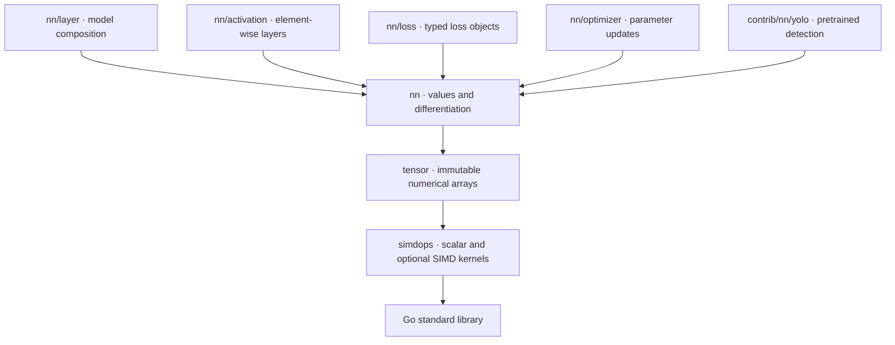

<div align="center">


# goml

**CPU-first numerical computing and machine learning, written in Go.**


[](LICENSE)

[Quick start](#quick-start) ·
[Tensor API](#tensor-api) ·
[Training](#training) ·
[Performance](#performance) ·
[Documentation](docs/README.md)

</div>

---

goml connects three independently usable libraries: slice kernels, N-dimensional
tensors, and neural networks. Use `simdops` for allocation-free vector operations.
Use `tensor` for numerical arrays. Add `nn` when you need differentiation and training.

The CPU runtime uses Go and its standard library. Tensors contain `float32` values,
views share immutable storage, and training uses eager reverse-mode differentiation.
Default builds use scalar kernels. Go's experimental portable SIMD API is optional.

**Module versions:** simdops v0.1.0, tensor v0.3.0, and nn v0.5.0.
The nn release includes convolutional, recurrent, transformer, checkpoint, pooling, SiLU, and spatial interpolation APIs.
The independent [YOLO module](contrib/nn/yolo/README.md) provides pretrained YOLOv8n CPU detection as `contrib/nn/yolo/v0.3.0`.
See the [layer guide](docs/layers.md) and [checkpoint contract](nn/checkpoint/README.md) for their APIs and examples.

The optional [Metal backend](contrib/backend/metal/README.md) adds persistent GPU tensors,
native matrix multiplication and convolution, GPU training, and YOLOv8n on Apple Silicon.
It owns all CGo and Apple framework integration. CPU applications retain their existing installation path.
These release targets require upstream publication in the [documented order](docs/releasing.md).

## Contents

- [Features](#features)
- [Install](#install)
- [Quick start](#quick-start)
- [How the modules fit together](#how-the-modules-fit-together)
- [Tensor API](#tensor-api)
- [Training](#training)
- [Memory and gradient ownership](#memory-and-gradient-ownership)
- [SIMD](#simd)
- [Performance](#performance)
- [Development](#development)
- [Troubleshooting](#troubleshooting)
- [Known limitations](#known-limitations)
- [Documentation](#documentation)
- [License](#license)

## Features

| Area | Available behavior |
| --- | --- |
| Slice kernels | Add, subtract, multiply, divide, scale, Axpy, dot, sum, and maximum over `[]float32`. Successful calls allocate no memory. |
| Numerical arrays | Scalars and N-dimensional tensors, checked shapes and strides, zero-sized dimensions, and bounded value previews. |
| Views | Transpose, half-open slicing, and contiguous reshape share storage. Explicit contiguous conversion copies logical values. |
| Tensor mathematics | Trailing-dimension broadcasting, reductions, Exp, Log, Sqrt, and 2D matrix multiplication over contiguous or strided inputs. |
| Differentiation | Eager reverse-mode graphs, shared-dependency accumulation, broadcast gradients, and consuming backward passes. |
| Models | Dense layers, ReLU, Sigmoid, Tanh, and Sequential composition with seeded Xavier initialization. |
| Additional models | Conv2D, RNN, LSTM, multi-head self-attention, LayerNorm, positional encoding, and transformer encoder blocks. |
| Checkpoints | Save weights or complete built-in Sequential networks, preserving shared layers and exact float32 values. |
| Training | Typed MSE and cross-entropy loss objects, SGD, Adam, and explicit inference without gradient graphs. |
| Verification | Numerical references, finite-difference checks, fuzzing, race detection, linting, and measured performance baselines. |
| Object detection | Independent contrib/nn/yolo module with pretrained YOLOv8n conversion, loading, image inference, decoding, and NMS. |
| Spatial transforms | MaxPool2D and Upsample2D with nearest, bilinear, or bicubic interpolation. |
| Metal | Explicit transfers, resident tensor operations, eager gradients, SGD, Adam, and YOLO inference on supported Macs. |
| Tooling | A Go workspace with separate CPU and opt-in Metal mise tasks. GitHub workflows use the same tasks. |

## Install

From your application's Go module, install the library you need:

```sh
go get github.com/bpradana/goml/simdops@v0.1.0
go get github.com/bpradana/goml/tensor@v0.3.0
go get github.com/bpradana/goml/nn@v0.5.0
```

Each command includes that module's dependencies. Go 1.27.3 or later is required.

## Quick start

Install [mise](https://mise.jdx.dev/). Run these commands from the local `goml` directory:

```sh
mise install --locked
mise run test
mise run example:tensor
```

The tensor example prints the original array, its transposed view, and their matrix product:

```text
tensor(shape=[2 3], data=[1 2 3 4 5 6])
tensor(shape=[3 2], data=[1 4 2 5 3 6])
tensor(shape=[2 2], data=[14 32 32 77])
```

Run a complete training example:

```sh
mise run example:linear
mise run example:xor
```

Run these additional generated-data training examples:

```sh
mise run example:cnn
mise run example:rnn
mise run example:lstm
mise run example:transformer
```

See the [example guide](nn/examples/README.md) for model shapes, tasks, and convergence checks.

The seeded XOR example trains a 2 → 8 → 1 network for 1,000 Adam steps.
Its convergence check requires every prediction to be within 0.1 of its target.
The [MNIST example](nn/examples/mnist/README.md) reads explicitly downloaded local
IDX files. Ordinary tests do not download datasets.

If personal global mise tools interfere with locked installation, use the
[project-only installation command](docs/development.md#install-the-project-tools).

## How the modules fit together



| Module | Import path | Guide |
| --- | --- | --- |
| simdops | `github.com/bpradana/goml/simdops` | [Slice APIs and numerical contracts](simdops/README.md) |
| tensor | `github.com/bpradana/goml/tensor` | [Arrays, views, and mathematics](tensor/README.md) |
| nn | `github.com/bpradana/goml/nn` | [Differentiation and model training](nn/README.md) |
| yolo | `github.com/bpradana/goml/contrib/nn/yolo` | [Pretrained object detection](contrib/nn/yolo/README.md) |

Each module has its own `go.mod`. The root `go.work` selects local versions.
Layer, loss, and optimizer packages belong to the nn module. They do not create
additional modules. There is no root `go.mod`.

<details>
<summary><b>Source layout</b></summary>

| Source | Responsibility |
| --- | --- |
| `simdops/arithmetic.go`, `reduction.go` | Validated public slice APIs. |
| `simdops/internal/kernels/` | Scalar references and SIMD/fallback implementations. |
| `tensor/tensor.go`, `view.go` | Storage, metadata, indexing, and views. |
| `tensor/arithmetic.go`, `reduction.go`, `matmul.go` | Numerical operations and 2D multiplication. |
| `tensor/internal/shape/` | Checked layouts and broadcast compatibility. |
| `nn/value.go`, `autograd.go`, `operation.go` | Values, graph traversal, and custom backward registration. |
| `nn/layer/` | Dense, convolutional, recurrent, attention, pooling, interpolation, and Sequential composition. |
| `nn/activation/` | ReLU, Sigmoid, Tanh, SiLU, and Softmax with their derivative rules. |
| `nn/loss/` | Loss interface, MSE, and stable cross-entropy implementations. |
| `nn/optimizer/` | SGD, Adam, and optimizer state. |
| `nn/checkpoint/` | Checked weight files and complete built-in network persistence. |
| `nn/examples/` | Generated-data training examples and local-data MNIST. |
| `contrib/nn/yolo/` | Independent YOLOv8n inference, model archives, and offline conversion. |
| `docs/` | Architecture, contracts, development, validation, and releases. |
| `.github/workflows/` | Quality, SIMD, converter checks, benchmarks, and module release notes. |

Implementation files have matching test files where they contain testable behavior.
See the [architecture guide](docs/architecture.md) for boundaries and ownership.

</details>

## Tensor API

This complete program computes a Gram matrix:

```go
package main

import (
	"fmt"
	"log"

	"github.com/bpradana/goml/tensor"
)

func main() {
	a, err := tensor.From([]float32{1, 2, 3, 4, 5, 6}, 2, 3)
	if err != nil {
		log.Fatal(err)
	}

	at, err := a.Transpose()
	if err != nil {
		log.Fatal(err)
	}

	product, err := tensor.MatMul(a, at)
	if err != nil {
		log.Fatal(err)
	}

	fmt.Println(product)
}
```

```text
tensor(shape=[2 2], data=[14 32 32 77])
```

Arithmetic allocates results and broadcasts trailing dimensions.
For example, `[32,128] + [128]` produces `[32,128]`.
A scalar has shape `[]` and one element. Zero-length dimensions are valid.

`Reshape` requires contiguous storage and an unchanged element count.
It returns an error for unsupported noncontiguous reshapes.
Use `Contiguous` when you want an explicit copy.
The [tensor contract](docs/tensor-semantics.md) defines indexing, reductions,
empty arrays, numerical edge cases, and sharing.

## Training

The training packages separate model structure, objectives, and updates:

| Package | Main API | Role |
| --- | --- | --- |
| `nn` | `Value`, `Parameter`, numerical operations | Record and differentiate computations. |
| `nn/layer` | `Layer`, `NewDense`, `NewSequential` | Compose model forward passes. |
| `nn/loss` | `Loss[T]`, `NewMSE`, `NewCrossEntropy` | Compute scalar objectives with typed targets. |
| `nn/optimizer` | `Optimizer`, `NewSGD`, `NewAdam` | Update parameters and manage optimizer state. |

A training iteration calls Forward, computes the loss, calls Backward, applies Step,
then clears gradients with ZeroGrad. Every iteration creates a new forward graph.

MSE takes `*nn.Value` targets. Cross-entropy takes `[]int` class labels and finite
logits shaped `[batch,classes]`. Its shifted log-sum-exp calculation avoids
a separate naive softmax/log operation.

A constant input still records a graph when combined with trainable parameters.
Use `nn.Inference` or `Sequential.Predict` for inference.
The [nn guide](nn/README.md) contains a complete training program.

## Memory and gradient ownership

| Operation or object | Ownership rule |
| --- | --- |
| Tensor construction from a slice | Copies the input values and shape. |
| Shape, Strides, and Data | Return independent copies. |
| Transpose, Slice, contiguous Reshape | Share immutable backing storage. |
| Contiguous | Always materializes independent row-major storage. |
| Tensor arithmetic | Allocates a new result. |
| Value | Owns its graph references and accumulated gradient. |
| Backward | Accumulates gradients and consumes the forward graph. |
| Parameter | Keeps its identity while updates replace immutable tensor data. |
| Optimizer | Owns Adam moments and its parameter list. |

Immutable reads and inference can share a model while parameters remain unchanged.
Training, backward, parameter updates, and gradient clearing require external synchronization.

## SIMD

Default builds need no experiment flags. To verify the experimental path, run:

```sh
mise run test:simd
GOEXPERIMENT=simd mise run bench:simdops
```

Experimental kernels use build constraints and keep SIMD types out of the public API.
Arithmetic uses vector operations with scalar tails.
Dot, Sum, and Max retain scalar implementations.

SIMD is workload-dependent. The measured eight-element Add case is slower than its
scalar reference. Larger cases show modest gains on the measured CPU.

## Performance

The [performance report](docs/performance.md) records medians from three 100ms samples
on an Apple M1 Pro, macOS arm64, Go 1.27.3.
The [CPU optimization report](docs/performance/cpu.md) compares the current
MatMul, convolution, tensor, training, and model workloads against their baseline.

| Add size | Scalar reference | Experimental SIMD | Scalar / SIMD |
| --- | --- | --- | --- |
| 8 | 5.768 ns/op | 8.655 ns/op | 0.67× |
| 1,024 | 666.4 ns/op | 568.3 ns/op | 1.17× |
| 65,536 | 41,088 ns/op | 36,079 ns/op | 1.14× |

These comparisons use the same SIMD-enabled binary and allocate zero bytes.
They describe one machine, not a universal performance guarantee.

```sh
mise run bench:record
```

This task records hardware metadata and repeated scalar/SIMD results in
`benchmark-results/`. Raw local results are ignored by Git.
The manual benchmark workflow uploads its results as workflow artifacts.

## Development

| Purpose | Command |
| --- | --- |
| Format and fix whitespace | `mise run fmt` |
| Test one module | `mise run test:tensor` |
| Lint one module | `mise run lint:nn` |
| Run local quality gates | `mise run check` |
| Run CI checks and vulnerability analysis | `mise run ci` |
| Run race tests | `mise run test:race` |
| Fuzz shapes, broadcasting, and views | `mise run test:fuzz` |
| Cross-compile Linux amd64/arm64 without CGo | `mise run build:portable` |
| Read package APIs locally | `mise run docs:api` |
| List every task | `mise tasks` |

The [development guide](docs/development.md) covers pinned tools, task categories,
dependency maintenance, and troubleshooting.
The [validation guide](docs/testing.md) records what has been verified.

## Troubleshooting

| Symptom | What to check |
| --- | --- |
| `go test ./...` fails at the repository root | This is a multi-module workspace. Use `mise run test`. |
| A standalone downstream check reports missing dependencies or checksums | Run that module's `deps:tidy` task. For new releases, confirm the upstream tag is public and Go's proxy has refreshed. |
| Reshape rejects a transposed array | Materialize it with `Contiguous`, then reshape. |
| Backward reports a consumed graph | Run Forward again. Detach only when you intend to use a result as a constant. |
| Parameters receive no gradients | Check for inference mode or detached inputs in the differentiable path. |
| A second optimizer step repeats the previous update | Step retains gradients. Call ZeroGrad before the next accumulation. |
| MNIST cannot open an IDX file | Download the data explicitly or supply local paths. See the [example setup](nn/examples/mnist/README.md). |

## Known limitations

- **Float32 only.** No dynamic dtype system, float64, or mixed precision.
- **Execution.** CPU builds remain pure Go. Metal is an explicit macOS/CGo dependency. CUDA and ROCm are unimplemented reservations.
- **2D matrix multiplication.** Blocking and selective RHS packing are supported; batched products and parallel matrix workers are not.
- **Basic indexing.** Unit-step slices and axis permutations, without advanced indexing or negative axes.
- **Eager graphs.** Backward consumes each graph. There is no retain-graph option, higher-order differentiation, or graph compiler.
- **Initial model implementations.** Conv2D uses square kernels without groups or dilation. Recurrent layers are unidirectional. Transformer blocks have no dropout, padding masks, or decoder.
- **Checkpoint scope.** Built-in Sequential networks and weights are supported. Optimizer state, runtime recurrent state, and distributed training are excluded. The separate YOLO module converts one supported pretrained format.
- **Release evidence.** Native amd64 execution and real-dataset MNIST accuracy remain open validation items. New downstream standalone checks require published upstream versions.

## Documentation

| Start here | Read next |
| --- | --- |
| [Documentation map](docs/README.md) | Choose a guide by task. |
| [Architecture](docs/architecture.md) | Module boundaries, source layout, and ownership. |
| [Tensor semantics](docs/tensor-semantics.md) | Shapes, views, broadcasting, reductions, and errors. |
| [Autograd](docs/autograd.md) | Graph lifecycle, gradients, loss targets, and inference. |
| [Neural network layers](docs/layers.md) | Convolution, recurrent state, attention, and transformer contracts. |
| [Checkpoints](nn/checkpoint/README.md) | Weight files, network serialization, validation, and loading semantics. |
| [Development](docs/development.md) | Tools, tasks, dependencies, and troubleshooting. |
| [Validation](docs/testing.md) | Numerical references, fuzzing, portability, and current evidence. |
| [Performance](docs/performance.md) | Measurements, method, tradeoffs, and reproduction. |
| [Releasing](docs/releasing.md) | Independent versions and publication order. |

See [CONTRIBUTING.md](CONTRIBUTING.md) for code style, paired tests, and contribution checks.

## License

goml is licensed under the [MIT License](LICENSE).
