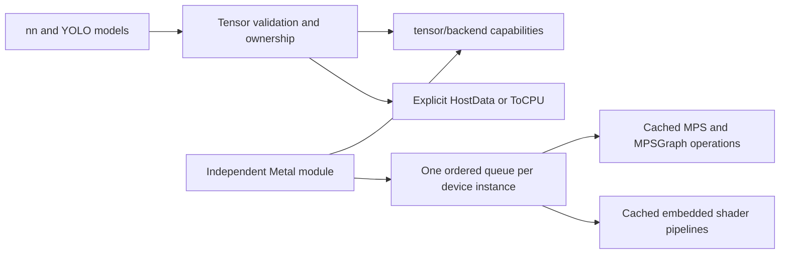

<div align="center">


# metal

**Persistent Float32 GPU computation for goml on Apple Metal.**


[](../../../LICENSE)

[Quick start](#quick-start) · [Operations](#operations) · [Ownership](#ownership) · [Validation](#validation) · [Project](../../../README.md)

</div>

---

Metal implements tensor's device contracts through a small Objective-C bridge.
MPS performs matrix multiplication. MPSGraph performs NCHW convolution and its gradients.
Embedded Metal shaders provide arithmetic, reductions, views, pooling, and interpolation.
Weights and intermediate tensors remain on the GPU until an explicit host transfer.

This independent module depends on tensor. It does not import nn or YOLO.
[Model examples and integration tests](examples/README.md) belong to a separate development module.
CPU tensor and nn users retain their pure-Go installation path.

## Requirements and installation

Native execution requires macOS, CGo, Xcode command-line tools, and a supported Metal GPU.
The implementation is tested on Apple M1 Pro hardware. Linux, Windows, and builds with
CGo disabled compile a stub whose Open function returns an unsupported-platform error.

The release target is `contrib/backend/metal/v0.1.0`, requiring tensor v0.3.0.
Publish the compatible upstream versions before installing the tagged module:

```sh
go get github.com/bpradana/goml/contrib/backend/metal@v0.1.0
```

The backend links Foundation, Metal, MetalPerformanceShaders, and MetalPerformanceShadersGraph.
It has no OpenBLAS, Gonum, CUDA, or HIP dependency.

## Quick start

From the repository workspace:

```sh
mise run example:gpu:matmul
```

The [complete example](examples/matmul/main.go) uploads two rectangular matrices,
computes their product, downloads the result, and releases its scope and device.
Its output on the development machine is:

```text
Apple M1 Pro: shape=[2 2] values=[4 5 10 11]
```

The core sequence is:

```go
device, err := metal.Open()
if err != nil {
	return err
}
defer func() { _ = device.Close() }()

scope, err := tensor.NewScope(device)
if err != nil {
	return err
}
defer func() { _ = scope.Close() }()

a, err := scope.To(left)
if err != nil {
	return err
}

b, err := scope.To(right)
if err != nil {
	return err
}

result, err := tensor.MatMul(a, b)
if err != nil {
	return err
}

values, err := result.HostData()
if err != nil {
	return err
}
```

## Operations

| Area | Device execution |
| --- | --- |
| Arithmetic | Add, Sub, Mul, Div, Scale, Neg, and scalar addition. |
| Mathematics | Exp, Log, Sqrt, ReLU, Sigmoid, Tanh, and SiLU. |
| Reductions | Sum, Mean, and Max over selected axes with NaN propagation. |
| Layout | Strided reads, broadcasting, transpose and slice views, contiguous materialization, concatenation, and gradient scatter. |
| MatMul | MPS Float32 rectangular and irregular matrix multiplication, including zero dimensions. Strided inputs are materialized on-device. |
| Convolution | MPSGraph NCHW cross-correlation, stride, padding, bias, and input/weight gradients. No host im2col. |
| Spatial operations | MaxPool2D and Upsample2D with nearest, bilinear, and bicubic forward/backward kernels. |
| Existing nn models | Dense, convolution, activations, LayerNorm, attention, recurrent state, and transformer composition through tensor operations. |
| Training | Device-correct eager backward seeds, leaf-gradient accumulation, resident SGD, and resident Adam moments. |
| Checkpoints | Explicit host transfers into the existing portable format. Restored networks start on CPU. |
| YOLOv8n | Resident weights and activations, three GPU output heads, explicit download, CPU decoding, and NMS. |

GPU views support up to eight dimensions and 32-bit element indexing.
Allocation limits also depend on available memory and Metal's maximum buffer length.
Unsupported operations return errors. They do not fall back to CPU computation.
Float32 results can differ from CPU references because reduction and multiplication orders differ.

## Architecture



Metal implements the typed optional capabilities in `tensor/backend`. Its
production Go package imports those contracts without importing Tensor or
NeuralNet. Arithmetic, MatMul, reductions, layout, convolution, and spatial
operations have separate source files and matching tests.

Embedded sources live in [kernels/](kernels/README.md), grouped into common
definitions, arithmetic, layout, reductions, and spatial operations. The native
bridge assembles them into one library during initialization. MatMul and
convolution continue using MPS and MPSGraph through the Objective-C bridge;
they do not need duplicate shader files.

Open compiles the embedded shader library once and caches compute pipelines.
Every device instance owns its queue, caches, and allocation registry.
A device mutex serializes encoding. Independent goroutines can operate through
separate scopes on one device. Training and parameter updates require external synchronization.

Arithmetic commands are batched and submitted after 64 encoded operations.
Convolution uses ordered MPSGraph command buffers on the same queue.
Operations enqueue work without waiting for each individual result.
Synchronize waits explicitly and reports asynchronous execution errors.
Downloads wait for earlier commands. Upload synchronizes before modifying native storage.
Backward and optimizer commits synchronize before replacing gradients or parameters.

## Ownership

| Object | Responsibility |
| --- | --- |
| Device | Close after use. Shutdown waits for pending commands and invalidates outstanding allocations. |
| GPU tensor | Owns one storage lease. Close releases that lease. |
| Tensor view | Owns an independent lease. Closing its parent does not invalidate it. |
| Scope | Owns temporary tensor leases propagated from its inputs. Close at the end of an inference or training iteration. |
| Kept output | Keep detaches its lease from a scope. The caller must close it later. |
| Parameter | Owns a persistent lease. Update replaces that lease while preserving parameter identity. |
| Leaf gradient | Owns a lease until ZeroGrad. It survives closure of a forward scope. |
| Adam | Owns persistent moment tensors. Close the optimizer to release them. |

Pending commands retain native resources until completion, even if tensor leases close earlier.
Explicit cleanup waits for concurrent Go cleanup callbacks to finish releasing references.
Go cleanup callbacks are a safety net for abandoned values.
They do not replace scopes, tensor Close, optimizer Close, or device Close.

HostData and ToCPU explicitly read host values. MakeContiguous materializes
independent storage on the current device; Retain shares immutable storage.
At returns an error for GPU storage. String displays metadata without downloading values.
See the [migration and ownership guide](../../../docs/gpu.md).

## Models and examples

```sh
mise run example:gpu:training
mise run example:gpu:training -- -checkpoint /tmp/linear.goml
mise run example:gpu:yolo -- -model archive/yolo/yolov8n.goml -image archive/yolo/bus.jpg -size 640
```

The training example learns `y = 2x + 1` with GPU-resident parameters and gradients.
The YOLO example requires an explicitly converted local archive and image.
It downloads final output heads for CPU postprocessing. No model or dataset is downloaded automatically.

## Validation

```sh
mise run fmt:check:metal
mise run lint:gpu:metal
mise run lint:gpu:examples
mise run test:backend:metal
mise run test:gpu:parity
mise run test:gpu:race
mise run bench:gpu:metal
```

Enable pretrained integration validation explicitly:

```sh
GOML_YOLO_MODEL="$PWD/archive/yolo/yolov8n.goml" mise run test:gpu:parity
GOML_YOLO_MODEL="$PWD/archive/yolo/yolov8n.goml" mise run bench:gpu:models
```

[Measured results](../../../docs/performance/metal.md) separate resident computation,
transfers, startup, and complete detection. Stats reports tracked native buffer bytes and
its high-water mark, including buffers retained by pending commands.
MPS-private workspaces are excluded from these totals. Go benchmark allocation counts exclude native memory.

## Releases and related guides

Metal v0.1.0 requires tensor v0.3.0. The integration examples use nn v0.6.0 and YOLO v0.3.1; publish those upstream versions before standalone example validation.
Release Metal only after its tensor dependency resolves with GOWORK=off and native hardware tests pass.
The examples module is validated through go.work and has no release target.
CUDA and ROCm remain unimplemented source reservations.

- [Backend contract](../../../docs/backend-contract.md).
- [Contributor tutorial](../../../docs/extending-backends.md).
- [API migration](../../../docs/backend-migration.md).
- [GPU architecture, migration, and phase evidence](../../../docs/gpu.md).
- [Performance report](../../../docs/performance/metal.md).
- [Release procedure](../../../docs/releasing.md).
- [go-mm reference](https://github.com/mikecvet/go-mm), which informed the native integration approach.

The logo identifies the goml backend. It is not an Apple product logo.
Licensed under [MIT](../../../LICENSE).
