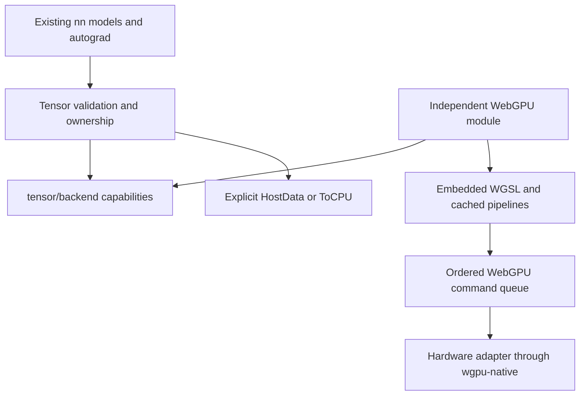

<div align="center">


# webgpu

**Persistent Float32 GPU computation for goml through WebGPU and WGSL.**


[Quick start](#quick-start) · [Operations](#operations) · [Ownership](#ownership) · [Validation](#validation) · [Project](../../../README.md)

</div>

---

webgpu implements the focused [tensor/backend](../../../tensor/backend) contracts
using persistent GPU buffers, embedded WGSL shaders, and an ordered command queue.
Tensor validates mathematical shapes and chooses capabilities. The backend checks
physical bounds, context ownership, and hardware limits before encoding work.
Results stay on the GPU until an explicit host read or transfer.

The module path is `github.com/bpradana/goml/contrib/backend/webgpu`.
It depends on tensor v0.3.0 and the pinned
[oliverbestmann/webgpu v1.38.1 binding](https://github.com/oliverbestmann/webgpu/tree/v1.38.1).
The runtime imports neither nn nor YOLO. The separate [examples module](examples/README.md)
contains neural-network integration workloads. CPU-only applications need not
import this module and keep their pure-Go build path.

## Requirements and installation

Native execution requires CGo, a supported C toolchain, and a hardware WebGPU
adapter on macOS, Linux, or Windows, using amd64 or arm64. The binding supplies
pinned wgpu-native libraries through platform-specific Go modules. Their initial
download is larger than an ordinary Go-only dependency.

wgpu-native selects Metal, Vulkan, or Direct3D 12 according to the adapter and
platform. This backend does not implement goml's reserved CUDA or ROCm modules.
Software adapters are rejected. Missing hardware returns an explicit unsupported
error instead of silently running numerical kernels on the CPU.

macOS requires Xcode command-line tools. Linux and Windows require the matching
native development/link libraries and a suitable graphics driver; consult the
[binding's build requirements](https://github.com/oliverbestmann/webgpu/tree/v1.38.1#building).
Native hardware validation is performed on Apple M1 Pro. Other platforms need
their own hardware validation before performance or parity claims.

Builds without CGo, unsupported operating systems/architectures, and browser
js/wasm builds compile an explicit unsupported stub. Browser execution is not
implemented in this release.

The initial release target is `contrib/backend/webgpu/v0.1.0`. After that tag is
published, install it from an application module:

```sh
go get github.com/bpradana/goml/contrib/backend/webgpu@v0.1.0
```

During development, use the committed Go workspace and mise tasks below.

## Quick start

```sh
mise run example:gpu:webgpu:matmul
```

The [complete example](examples/matmul/main.go) opens one context, uploads two
rectangular matrices, computes the product, and explicitly downloads the result.
The core sequence is:

```go
device, err := webgpu.Open()
if err != nil {
	return err
}
defer func() { _ = device.Close() }()

left, err := tensor.FromOn(device, []float32{1, 2, 3, 4, 5, 6}, 2, 3)
if err != nil {
	return err
}
defer func() { _ = left.Close() }()

right, err := tensor.FromOn(device, []float32{1, 0, 0, 1, 1, 1}, 3, 2)
if err != nil {
	return err
}
defer func() { _ = right.Close() }()

result, err := tensor.MatMul(left, right)
if err != nil {
	return err
}
defer func() { _ = result.Close() }()

values, err := result.HostData()
if err != nil {
	return err
}

fmt.Println(values) // [4 5 10 11]
```

`OpenDevice(index)` selects a native adapter by enumeration index. `-1` selects
the default hardware adapter. Each Open call creates a distinct execution context;
two contexts on the same GPU cannot share tensor operations or buffers directly.

## Operations

| Area | Device execution |
| --- | --- |
| Arithmetic | Add, Sub, Mul, Div, Scale, scalar addition, and causal masking. |
| Mathematics | Exp, Log, Sqrt, ReLU, Sigmoid, Tanh, SiLU, and activation derivatives. |
| Reductions | Sum, Mean, Max; selected axes, empty sums, and NaN propagation. |
| Layout | Strided reads, broadcasting, transpose/slice views, contiguous materialization, scatter, concatenation, and fills. |
| MatMul | 16×16 workgroup-tiled WGSL multiplication; rectangular, irregular, empty, and strided matrices. |
| Convolution | Direct NCHW cross-correlation with flattened weights, bias, stride, padding, and input/weight derivatives. |
| Pooling | MaxPool2D forward and backward; overlapping windows and deterministic first-tie selection. |
| Interpolation | Integer-scale nearest, bilinear, and bicubic forward/backward with half-pixel coordinates. |
| Validation | On-device finite-value checks with only a four-byte status readback. |
| Neural networks | Existing models, eager autograd, and GPU-resident SGD/Adam through ordinary Tensor operations. |

Convolution does not download patches or use CPU im2col. It uses direct WGSL
gather kernels, including derivatives without floating-point atomics. It is a
correctness baseline rather than a claim of parity with the optimized MPS path.
Reductions currently assign one invocation per output group. Large reduction
groups and large convolution kernels can be slower than specialized native kernels.

Views support up to eight dimensions and 32-bit shader indexing. Buffer sizes and
dispatch grids are checked against the selected device's limits. Numerical
destinations must be nonoverlapping and cannot alias an input. Empty allocations
use a four-byte physical buffer to satisfy WebGPU binding rules.

Float32 reductions and fused arithmetic can differ from CPU results. Tests use
documented absolute-plus-relative tolerances. No bit-identical promise is made
for transcendental functions, subnormal arithmetic, or NaN payloads. Transfers and
copies preserve Float32 bits.

## Architecture and execution



Shader modules compile when the context opens. Pipeline states are cached per
device, not recreated per operation. Dispatch metadata is copied into private
GPU parameter buffers before a method returns. Borrowed Go shape/stride slices
are never retained asynchronously.

Operations are encoded in batches of up to 64 dispatches. Submission does not
wait for every operation. Synchronize waits explicitly and reports deferred
execution errors; Download waits before reading. Upload orders queued writes
after earlier operations using the same queue.

See the [kernel guide](kernels/README.md) for shader responsibilities and the
parameter ABI used by the Go/WGSL boundary.

## Ownership

| Object | Responsibility |
| --- | --- |
| Device | Close after use; shutdown waits and invalidates outstanding allocations. |
| Tensor | Owns a storage lease. Close on CPU and GPU. |
| View or Retain result | Owns an independent lease sharing immutable storage. |
| Scope | Owns temporary handles; close after a forward/training iteration. |
| Kept output | Keep removes its scope ownership; the caller later closes it. |
| Parameter | Owns a persistent lease; updates preserve parameter identity. |
| Adam | Owns device-resident moment tensors; close after training. |

Closed buffers needed by queued commands remain physically alive until completion.
Explicit Close and scopes define primary lifetimes. Garbage-collection cleanup is
a safety net, not a replacement for device and tensor cleanup.

HostData and ToCPU explicitly transfer host values. MakeContiguous copies on the
current device. At returns an unsupported error for accelerator indexing; String
reports metadata without synchronization or hidden downloads.

Stats reports tensor-buffer bytes and their high-water mark, including closed
allocations retained by pending work. Internal parameter/readback buffers and
driver workspaces are excluded. Synchronize before comparing quiescent totals.

## Models and examples

```sh
mise run example:gpu:webgpu:training
mise run example:gpu:webgpu:yolo -- -model data/yolo/yolov8n.goml -image data/yolo/bus.jpg -size 320
```

The [examples guide](examples/README.md) documents model setup, training cleanup,
and explicit local YOLO assets. No model weights or datasets are downloaded by
ordinary tests or examples. YOLO performs its final decoding and NMS on the CPU
after the explicit output readback.

## Validation

```sh
mise run build:gpu:webgpu
mise run fmt:check:webgpu
mise run lint:gpu:webgpu
mise run test:backend:webgpu
mise run test:gpu:webgpu:race
mise run test:gpu:webgpu:portable
mise run test:gpu:webgpu:parity
mise run bench:gpu:webgpu
```

Tests remain paired with their source files and run the common backendtest suites
for every claimed capability. Hardware tasks set `GOML_WEBGPU_REQUIRED=1`, so a
missing adapter fails rather than silently turning validation into skipped tests.
Ordinary tests may skip hardware cases only for an explicit unsupported adapter
or build; shader, execution, and numerical errors still fail.

The manual [WebGPU workflow](../../../.github/workflows/webgpu.yml) uses a
self-hosted macOS arm64 runner labeled `webgpu`. Configure that runner before
using hardware CI or publishing a WebGPU tag. Ordinary CPU CI does not need it.

The [validation report](../../../docs/performance/webgpu.md) records the measured
environment, numerical checks, benchmark results, and untested platforms. Benchmarks
separate initialization, resident execution, and transfer-inclusive work. Go
allocation counts do not include driver allocations. Raw results stay outside
the repository.

## Releases and related guides

Release this module with a `contrib/backend/webgpu/v...` subdirectory tag after
standalone validation against its published Tensor dependency. The examples
module has no release tag. CUDA and ROCm remain unimplemented reservations.

- [Backend contract](../../../docs/backend-contract.md).
- [Contributor tutorial](../../../docs/extending-backends.md).
- [API migration](../../../docs/backend-migration.md).
- [Release procedure](../../../docs/releasing.md).
- [Pinned Go binding](https://github.com/oliverbestmann/webgpu/tree/v1.38.1).
- [WebGPU specification](https://gpuweb.github.io/gpuweb/) and [WGSL](https://gpuweb.github.io/gpuweb/wgsl/).

The logo identifies the goml backend. It is not a WebGPU project or vendor logo.
Licensed under [MIT](../../../LICENSE).
