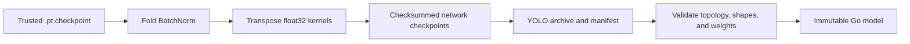

<div align="center">


# yolo

**Pretrained YOLOv8n object detection on the CPU, powered by goml.**


[Quick start](#quick-start) · [Go API](#go-api) · [Conversion](#weight-conversion) · [Validation](#numerical-validation) · [Project](../../../README.md)

</div>

---

yolo loads converted YOLOv8n detection weights and returns labeled bounding boxes from ordinary Go images.
Inference uses goml's float32 tensor and neural network libraries.
It requires no Python process, CGo, ONNX Runtime, GPU, or external inference service.

The module path is `github.com/bpradana/goml/contrib/nn/yolo`.
It has its own go.mod and release tag, `contrib/nn/yolo/v0.1.0`.
It requires nn v0.3.0 and tensor v0.1.0; simdops remains at v0.1.0.
Publish nn v0.3.0 before resolving this module outside the repository workspace.

## Supported model

| Area | Contract |
| --- | --- |
| Architecture | YOLOv8n detection, with the legacy three-scale detection head. |
| Weights | Official yolov8n.pt, or compatible fine-tuned weights with the same topology. |
| Input | One image, RGB, square model input at a multiple of 32 from 32 to 1280. |
| Output | Class ID, label, confidence, and clipped XYXY box in original image pixels. |
| Default settings | Size 640, confidence 0.25, class-aware NMS IoU 0.45, at most 300 detections. |
| Execution | Pure-Go, CPU-only float32 inference. No training graph is constructed. |
| Conversion | Offline Python tool pinned to Ultralytics 8.3.0 and PyTorch 2.5.1. |

Other YOLO families, larger width/depth variants, segmentation, pose, rotated boxes, and end-to-end heads are not supported.
The loader rejects incompatible weights and model topology.

## Quick start

From the repository root:

```sh
mise install --locked
mkdir -p data/yolo

curl -fL https://github.com/ultralytics/assets/releases/download/v8.3.0/yolov8n.pt \
  -o data/yolo/yolov8n.pt
curl -fL https://raw.githubusercontent.com/ultralytics/assets/main/im/bus.jpg \
  -o data/yolo/bus.jpg

mise run convert:yolo -- data/yolo/yolov8n.pt data/yolo/yolov8n.goml
mise run example:yolo -- -model data/yolo/yolov8n.goml -image data/yolo/bus.jpg -size 320
```

The conversion task installs its locked Python dependencies through uv.
On Linux amd64, the lock selects CPU-only PyTorch wheels.
The example prints a JSON array and returns a nonzero exit status on failure.
Use `-size 640` for the default model resolution; smaller inputs reduce CPU work and can change detections.
Downloaded weights, images, and reference artifacts stay in the ignored data directory.

The verified 320-pixel run on the bus image returns one bus and three people.
This is a functional example, not an accuracy evaluation.

After the module tags are published, install the Go library independently:

```sh
go get github.com/bpradana/goml/contrib/nn/yolo@v0.1.0
```

## Go API

Load once and reuse the model:

```go
model, err := yolo.Load("data/yolo/yolov8n.goml")
if err != nil {
    return err
}

options := yolo.DefaultOptions()
options.Size = 320

detections, err := model.Detect(source, options)
if err != nil {
    return err
}

for _, detection := range detections {
    fmt.Printf("%s %.3f %+v\n", detection.Label, detection.Confidence, detection.Box)
}
```

Here source is an `image.Image`.
Import `image/jpeg` and `image/png` for side effects when decoding those formats yourself.
The [complete CLI](cmd/yolo/main.go) shows image decoding, argument validation, and JSON output.

Classes returns a safe copy of labels indexed by ClassID.
Forward accepts an already prepared tensor `[1,3,size,size]` and returns the three raw heads at strides 8, 16, and 32.
Each head has shape `[1,64+classes,height,width]`.
The first 64 channels are four groups of sixteen box-distribution logits; the remaining channels are class logits.

All Options fields are explicit; start with DefaultOptions and change the settings you need.
Confidence and IoU must be in `[0,1]` and MaxDetections in `[1,10000]`.
Results are sorted by descending confidence; ties preserve anchor order.
Empty detections return a non-nil empty slice.

## Inference path

```mermaid
flowchart LR
    Image["Go image"] --> Prepare["RGB resize, letterbox, normalize"]
    Prepare --> Backbone["Convolutions and C2f blocks"]
    Backbone --> SPPF["Spatial pyramid pooling"]
    SPPF --> Neck["Upsample, concatenate, and refine"]
    Neck --> Heads["Three regression and classification heads"]
    Heads --> DFL["DFL distance decoding"]
    DFL --> NMS["Class-aware NMS"]
    NMS --> Boxes["Clipped boxes in original image pixels"]
```



Preprocessing uses bilinear half-pixel resizing, rounded 8-bit RGB pixels, centered padding of 114, and division by 255.
Nonzero image bounds work; alpha is ignored after conversion to unpremultiplied RGB.
Box restoration uses each axis's actual rounded resize scale.
Small differences from OpenCV's interpolation and rounding are expected.

Each anchor contributes its highest-probability class.
YOLOv8 detection has no separate objectness multiplier.
The decoder evaluates stable sixteen-bin softmax distributions and converts their expected distances into boxes.
NMS considers at most 30,000 confidence-sorted candidates and suppresses overlapping boxes only within the same class.

Model weights remain private and immutable.
Calls can share a loaded Model while allocating independent activations.
Execution is currently sequential, and convolution materializes patch matrices.
Large inputs increase latency and temporary memory; this implementation does not promise real-time detection.

## Weight conversion

The [converter](convert/README.md) loads a trusted PyTorch checkpoint, folds BatchNorm into convolution weights and biases, and transposes kernels from OIHW into goml's `[in*kernel*kernel,out]` layout.
It serializes learned blocks using the existing [nn/checkpoint format](../../../nn/checkpoint/README.md), including SiLU activations.
The source checkpoint is never modified.



Only the conversion step needs Python, PyTorch, and Ultralytics.
PyTorch .pt loading can execute serialized code; convert checkpoints from sources you trust.
Ultralytics software and downloaded model weights retain their [upstream licensing](https://www.ultralytics.com/license).
The goml source license does not change the license of converted weights.

## Archive format version 1

The ZIP contains manifest.json and 51 `networks/<name>.goml` checkpoints.
The manifest records architecture `yolov8n-detect`, class names, format version 1, and the source checkpoint's SHA-256 digest.
Names map to fixed YOLOv8n stages; no arbitrary graph or executable constructor is loaded.

Load validates all expected blocks, convolution geometry, ordered parameter shapes, finite weights, and inner checkpoint checksums.
Unknown entries, missing blocks, duplicates, invalid metadata, and corrupt ZIP or checkpoint data return errors.
Limits are 128 entries, 64 MiB compressed and uncompressed in total, 16 MiB per network, and 64 KiB for the manifest.
No archive entry is extracted to disk.
Checksums detect corruption; they do not authenticate the producer.

## Numerical validation

Ordinary tests require no weights, downloads, or Python:

```sh
mise run test:yolo
mise run lint:yolo
mise run test:converter
```

For the optional real-weight comparison, first let Go write the exact model input:

```sh
export GOML_YOLO_MODEL="$PWD/data/yolo/yolov8n.goml"
export GOML_YOLO_IMAGE="$PWD/data/yolo/bus.jpg"
export GOML_YOLO_REFERENCE="$PWD/data/yolo/reference-320"
export GOML_YOLO_SIZE=320

mise run test:yolo:reference
mise run reference:yolo -- data/yolo/yolov8n.pt data/yolo/reference-320 --size 320
mise run test:yolo:reference
```

The second Go run compares every raw head logit and the final class-aware NMS detections against pinned PyTorch.
The first run logs that references are absent and prepares input.f32; it does not claim parity yet.
The tested 320-pixel image produced matching class IDs and four retained detections, with maximum raw-logit absolute error below 0.00016.
See the [validation report](../../../docs/yolo-validation.md) for hardware, tolerances, and limitations.

## Development and releases

Run `mise run check` for the complete workspace, or the module-specific tasks above for a shorter loop.
The new primitives live in [nn/layer](../../../nn/layer/README.md) and [nn/activation](../../../nn/activation/README.md).
YOLO-specific C2f, bottleneck, SPPF composition, model conversion, decoding, and NMS stay in this module.

Release dependencies in order: `nn/v0.3.0`, then `contrib/nn/yolo/v0.1.0`.
After nn is published, run `GOWORK=off mise run deps:tidy:yolo`, commit the generated dependency checksums, and run `mise run test:standalone:yolo` before tagging YOLO.
The [release workflow](../../../.github/workflows/release.yml) recognizes the nested module tag and generates module-specific release notes.
Tensor and simdops require no new release.
