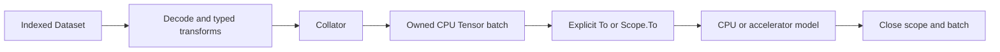

<div align="center">


# data

**Typed datasets and predictable batches for Go numerical applications.**


[Quick start](#quick-start) · [Datasets](#datasets) · [Ownership](#ownership) · [Examples](#examples) · [Project](../README.md)

</div>

---

data provides indexed datasets, synchronous epoch-based iteration, deterministic
shuffling, and contiguous CPU Tensor batches. Samples and collators are strongly
typed. A dataset can return images, regression values, tokens, annotations, or an
application-specific struct without registration or reflection.

The module is `github.com/bpradana/goml/data`. It depends on tensor v0.3.0 and
imports neither nn nor a concrete accelerator backend. Applications combine
these independent libraries when they need training or device execution.

## Installation

The initial release target is `data/v0.1.0`. After that tag is published:

```sh
go get github.com/bpradana/goml/data@v0.1.0
```

For the current development source, use the committed Go workspace. Linux,
macOS, and Windows builds need no CGo, native frameworks, or GPU hardware.
Dataset files and checkpoints belong under the ignored `archive/` directory,
separate from this module's source. No loader downloads data automatically.

## Quick start

The [classification example](examples/classification/main.go) builds a dataset
from a Tensor and uses a partial final batch:

```go
inputs, err := tensor.From([]float32{0, 0, 0, 1, 1, 0, 1, 1}, 4, 2)
if err != nil {
	return err
}
defer func() { _ = inputs.Close() }()

dataset, err := data.NewClassificationDataset(inputs, []int{0, 1, 1, 0})
if err != nil {
	return err
}

loader, err := data.NewLoader(
	dataset,
	data.CollateClassification,
	data.LoaderOptions{BatchSize: 3, Shuffle: true, Seed: 42},
)
if err != nil {
	return err
}

for batch, err := range loader.Batches(ctx, 0) {
	if err != nil {
		return err
	}

	fmt.Printf("shape=%v labels=%v\n", batch.Inputs.Shape(), batch.Labels)
	if err := batch.Close(); err != nil {
		return err
	}
}
```

Run the complete program with `mise run example:data:classification`.
The input dataset owns a snapshot, so closing the source Tensor does not
invalidate later sample reads. Each yielded batch owns its own Tensor handle.

## Datasets

| Package or constructor | Input | Sample |
| --- | --- | --- |
| `NewClassificationDataset` | Host-accessible Tensor and integer labels. | Copied input values, per-sample shape, and label. |
| `NewRegressionDataset` | Host-accessible input and target Tensors. | Copied input/target arrays and their shapes. |
| [datasets/mnist](datasets/mnist/README.md) | Standard local plain or gzip IDX files. | `[1,28,28]` Float32 values in `[0,1]` and integer label. |
| [datasets/csvdata](datasets/csvdata/README.md) | Explicit numerical CSV feature/target columns. | Finite Float32 vectors and integer or numerical targets. |
| [datasets/imagefolder](datasets/imagefolder/README.md) | Sorted class directories containing JPEG/PNG. | Lazily decoded RGB or grayscale CHW values and stable class label. |

Tensor-backed datasets require a leading sample dimension. `[1000,784]` inputs
produce `[784]` samples and `[batch,784]` batches. Regression targets have their
own fixed per-sample shape. Sources can be noncontiguous; construction copies
logical host values once. Accelerator sources are rejected until the caller
explicitly transfers them to CPU.

MNIST retains byte images and expands only requested samples. CSV datasets keep
parsed numeric data in host memory. ImageFolder retains paths and a rooted
directory handle, decodes each requested image independently, and never caches
decoded images indefinitely. Close an ImageFolder dataset after its readers finish.

## Loader and collation

```go
type Dataset[T any] interface {
	Len() int
	Get(context.Context, int) (T, error)
}

type CollateFunc[S, B any] func(samples []S) (B, error)
```

`NewLoader` takes a dataset, collator, and `LoaderOptions`. BatchSize must be
positive. File order is preserved unless Shuffle is enabled. A local PCG generator
and Fisher–Yates permutation use Seed and the nonnegative epoch number; repeated
seed/epoch pairs reproduce the same order. DropLast omits the incomplete final
batch. Empty datasets yield no batches.

A sample read, collation error, or canceled context is yielded once and stops
iteration. Errors are wrapped with sample/batch context and preserve `errors.Is`.
Breaking the loop stops further reads immediately. There are no workers,
channels, prefetch queues, or goroutines to clean up.

Built-in collators require nonempty sample lists and matching shapes. They
validate all samples, copy into contiguous CPU tensors, and preserve sample order.
Classification produces integer labels; regression produces a separate target
Tensor. Scalar targets become `[batch]`. Zero-sized sample dimensions are valid.
Variable-sized images must be transformed before classification collation.

A custom collator can return any concrete batch type, including variable-length
annotations or token lists. It owns cleanup of partial allocations on error.
Sample slices are borrowed for the call; copy what the returned batch retains.

## Preprocessing

The [transform package](transform/README.md) provides typed composition,
channel normalization, bilinear resize, center crop, HWC Float32 conversion,
and CHW image conversion. Shapes, channel order, alpha handling, and ranges are
explicit. Transforms copy input values and preserve labels.

Use `data.Map` to apply a custom typed transform to any dataset. ImageFolder
also accepts a sample transform directly. `data.Subset` selects copied indices
without changing source order or ownership. User-provided sources and transforms
must support concurrent use if the application calls Get concurrently.



## Ownership

| Object | Ownership and cleanup |
| --- | --- |
| Built-in sample | Owns its copied slices; ordinary Go lifetime. |
| Tensor-backed dataset | Owns a host snapshot; source Tensor can be closed. |
| Loader | Borrows the dataset; does not close datasets or successful batches. |
| ClassificationBatch | Owns Inputs and Labels; Close releases Inputs. |
| RegressionBatch | Owns Inputs and Targets; Close attempts both releases. |
| ImageFolder | Owns a directory handle; Close after readers finish. |
| GPU batch copy | Application owns the transferred handle or temporary Scope. |

Batch Close methods are nil-safe and idempotent. One batch's cleanup does not
invalidate another batch, its dataset, or an already transferred device tensor.
Every successful yield transfers batch responsibility to the caller, including
before an early break. The loader does not close previously yielded batches.

Keep temporary scopes inside a batch helper, so defer runs per batch rather than
at the end of a long epoch. Close the original CPU batch even when training fails.
GPU transfer and asynchronous native retention remain Tensor/backend responsibilities.
DataLoader never initializes a device or downloads a GPU dataset implicitly.

## Examples

```sh
mise run example:data
mise run example:data:mnist -- -data archive -model cnn -shuffle -seed 42
mise run example:data:mnist -- -data archive -evaluate
mise run example:data:mnist:metal -- -data archive -model cnn
```

- [Custom dataset and collator](examples/custom/README.md): arbitrary samples, variable token lengths, no registration.
- [Tensor classification batches](examples/classification/README.md): snapshot ownership, deterministic shuffling, partial batches.
- [MNIST training](../nn/examples/mnist/README.md): Dense/CNN, Adam, held-out evaluation, portable checkpoints, prediction, and opt-in Metal execution.
- [Contributor guide](../docs/datasets.md): contracts, extension points, and failure handling.

The MNIST application is a separate workspace module. Until data's initial tag
is published, it intentionally has no fabricated data dependency version. After
publication, add the real version and tidy its checksums before standalone use.
The nn library remains independent of data.

## Validation and performance

```sh
mise run test:data
mise run test:data:race
mise run test:standalone:data
mise run build:data:portable
mise run lint:data
mise run bench:data
mise run bench:mnist
```

Fixtures are small generated local files. Tests cover deterministic ordering,
partial batches, invalid data, context cancellation, concurrent reads, independent
ownership, strict IDX/gzip validation, CSV diagnostics, image bounds and symlinks,
and typed transforms. Optional `mise run test:data:metal` uses real Metal hardware.
Ordinary CPU CI includes the module and MNIST application without that prerequisite.

The [measurement report](../docs/performance/data.md) separates dataset access,
collation, decoding, end-to-end fixture training, and explicit GPU transfer costs.
Synchronous loading is the initial execution model; worker/prefetch options are
reserved until a measured workload justifies their implementation.

## Releases and related guides

Release with `data/v...`, after its published Tensor dependency resolves.
The MNIST examples module has no release tag. Existing published tags stay unchanged.

- [Tensor semantics](../docs/tensor-semantics.md).
- [Neural network examples](../nn/examples/README.md).
- [Development](../docs/development.md).
- [Release procedure](../docs/releasing.md).

Licensed under [MIT](../LICENSE).
