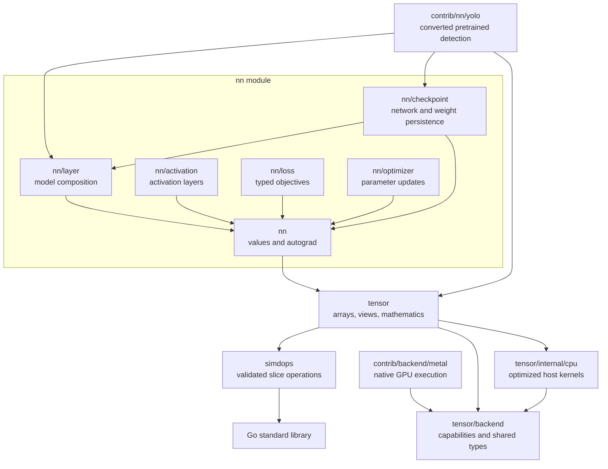
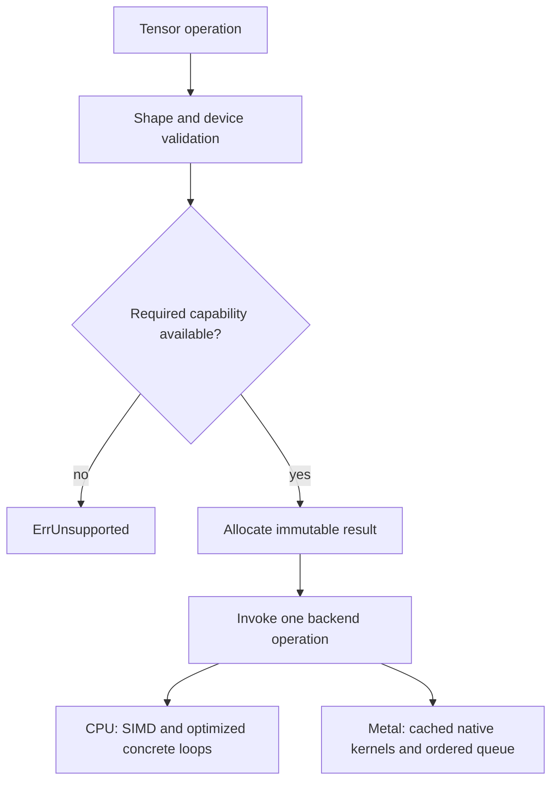
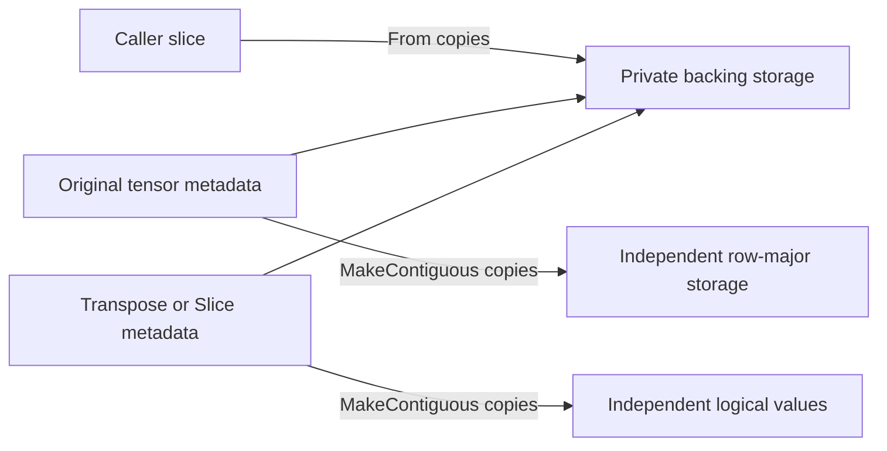

# Architecture

[Documentation](README.md) · [Project overview](../README.md)

goml separates slice kernels, numerical arrays, and differentiation into three Go modules.
Each module can be imported and released independently.
A fourth module, contrib/nn/yolo, provides pretrained YOLOv8n inference on top of nn.
The independent contrib/backend/metal module implements the tensor/backend contracts.
This guide explains their boundaries and the execution model.

## Dependency direction

| Module | Owns | Does not own |
| --- | --- | --- |
| [simdops](../simdops/README.md) | Slice validation, scalar references, optional SIMD arithmetic. | Tensor layouts, graphs, model parameters. |
| [tensor](../tensor/README.md) | Immutable float32 storage, shapes, strides, views, numerical operations. | Gradient tracking, optimizer state, layers. |
| [nn](../nn/README.md) | Differentiable values, graphs, parameters, model composition, objectives, updates. | SIMD dispatch, tensor storage mutation, device backends. |

nn and its subpackages import tensor and never import simdops directly.
The internal CPU backend imports simdops for contiguous arithmetic.
CPU execution has no third-party runtime dependencies beyond the three-module chain.
Metal imports tensor/backend and owns the CGo bridge. Tensor and nn do not import native backends.

## Workspace and versioned modules

The root [go.work](../go.work) selects `simdops`, `tensor`, `nn`, and `contrib/nn/yolo`.
It also selects Metal and its separate development examples module.
CUDA and ROCm reservations remain outside the workspace.
There is no root `go.mod`.
The workspace resolves local changes without relative replace directives.

| Manifest | Versioned dependency |
| --- | --- |
| [simdops/go.mod](../simdops/go.mod) | Standard library only. |
| [tensor/go.mod](../tensor/go.mod) | `github.com/bpradana/goml/simdops v0.1.0` |
| [nn/go.mod](../nn/go.mod) | `github.com/bpradana/goml/tensor v0.3.0` |
| [contrib/nn/yolo/go.mod](../contrib/nn/yolo/go.mod) | `github.com/bpradana/goml/nn v0.6.0` and `tensor v0.3.0` |
| [contrib/backend/metal/go.mod](../contrib/backend/metal/go.mod) | `github.com/bpradana/goml/tensor v0.3.0` |

The version declarations target simdops v0.1.0, tensor v0.3.0, and nn v0.6.0.
Workspace tests use local modules, while standalone checks require published dependencies.

Subpackages are organizational boundaries inside a module.
The layer, loss, and optimizer packages do not have separate manifests or release tags.
See [releasing](releasing.md) for dependency order and checksum generation.

## Numerical execution

[Tensor arithmetic](../tensor/arithmetic.go) validates and dispatches.
[CPU arithmetic](../tensor/internal/cpu/arithmetic.go) preserves contiguous SIMD
and efficient broadcast traversal. [Shape helpers](../tensor/internal/shape/)
validate common mathematical layouts. [Backend contracts](backend-contract.md)
define execution, storage, and ownership; [extending backends](extending-backends.md)
walks through a compilable independent implementation.

The [simdops API](../simdops/arithmetic.go) validates lengths before writing.
Its [private kernels](../simdops/internal/kernels/) assume those validated lengths.
Complementary build constraints select scalar or experimental arithmetic.

Dot and Sum retain scalar accumulation order.
Max also remains scalar.
The public API contains no experimental vector types.

## Tensor storage and views

Tensor stores a backend-owned storage reference, a device, shape, strides, offset, and logical element count.
Contiguous arrays use row-major order.
Views change metadata and share immutable storage.

Shape and Strides return copies. HostData explicitly reads a fallible logical-value copy.
Public operations cannot expose writable broadcast storage.
Reshape shares storage only for supported contiguous layouts.

The [tensor contract](tensor-semantics.md) defines zero-sized dimensions,
overflow validation, indexing, and numerical edge cases.

## Graph ownership

A [Value](../nn/value.go) wraps an immutable tensor and optional differentiation state.
Operations compute results immediately.
They record parent lists and backward closures only when tracking is required.

[Backward](../nn/autograd.go) performs these stages:

1. Validate the reachable graph and seed.
2. Build a topological order.
3. Propagate per-pass gradients in reverse order.
4. Accumulate the completed pass into stored gradients.
5. Release saved graph resources and mark operation nodes consumed.

Per-pass gradients are separate from previously accumulated gradients.
This prevents an older contribution from propagating through a new branch twice.

Parameters preserve their leaf identity across iterations.
Updates replace immutable tensor data.
Saved backward operations retain the immutable values needed from their forward pass.

Inference suppresses graph recording throughout the operation path.
There is no global graph registry or global gradient mode.
See [autograd](autograd.md) for lifecycle details and failure contracts.

## Composition boundaries

| Package | Interface | Reason |
| --- | --- | --- |
| [nn/layer](../nn/layer/layer.go) | `Layer`: Forward and Parameters. | Sequential composes different layer implementations. |
| [nn/activation](../nn/activation/doc.go) | Implements the existing Layer contract. | Parameterless layers compose without a duplicate interface. |
| [nn/loss](../nn/loss/loss.go) | `Loss[T]`: Forward. | A training loop can substitute objectives with the same target type. |
| [nn/optimizer](../nn/optimizer/optimizer.go) | `Optimizer`: Step and ZeroGrad. | Training loops can substitute update algorithms. |

The root nn package does not import these subpackages.
Activation implementations live in nn/activation and reuse the Layer contract.
Loss implementations live in nn/loss. MSE composes public nn operations.
Activations and CrossEntropy register validated single-input backward rules through nn.NewOperation.
LayerNorm uses nn.NewMultiOperation to connect input, scale, and bias gradients.
Recurrent and attention layers compose ordinary differentiable operations.
Conv2D training extracts differentiable patches before matrix multiplication;
CPU inference uses bounded patch tiles in the CPU backend and writes NCHW output directly.
Metal uses native MPSGraph forward and backward convolution.
The [layer guide](layers.md) shows the model paths and shape contracts.

MSE uses `*nn.Value` targets.
Cross-entropy uses `[]int` class labels.
The generic loss interface preserves this distinction without runtime type assertions.

## Concurrency and performance boundaries

CPU kernels and matrix multiplication execute sequentially.
There are no global pools, worker engines, or per-element goroutines.

Immutable tensor reads can run concurrently.
Inference can share a model while parameters remain unchanged.
Backward, optimizer updates, and gradient clearing require external synchronization.

The current matrix implementation improves traversal while retaining reference accumulation order.
Existing blocked traversal and selective packing remain in the CPU backend.
Additional buffer reuse and parallel workers require benchmark evidence.
The [performance report](performance.md) records the existing baseline.

## Scope

The current architecture supports float32 arrays, first-order eager differentiation, and CPU neural networks.
nn v0.6.0 includes convolution, spatial pooling and interpolation, recurrent layers, transformer encoder blocks, and model persistence, with optimized CPU numerical kernels.
YOLO-specific blocks, archive loading, conversion, decoding, and NMS stay in contrib/nn/yolo.
The Python converter is an offline tool; no Python or third-party inference runtime is needed by the Go module.
The optional Metal backend supplies explicit transfers and GPU computation through tensor contracts.
CPU paths remain pure Go. There is no goml JIT, compiled graph engine, or distributed-training layer.
See [GPU ownership and migration](gpu.md) for device execution and native resource boundaries.

Future numerical types and additional operations must preserve the ownership and dependency boundaries.
The public backend contract supports independently implemented capabilities.
It does not introduce a plugin registry, dynamic loader, or scheduling framework.

## Persistence boundaries

The checkpoint package owns the versioned file format, tensor byte encoding, checksums, and file replacement.
`layer.MarshalConfig` and `layer.Restore` own architecture descriptions and concrete layer reconstruction.
Restoration uses supplied tensors without allocating random weight arrays.

Network metadata references shared layers and parameters by index.
It does not serialize autograd nodes, optimizer state, or arbitrary Go objects.
The root nn package does not import checkpoint, and tensor remains independent of model persistence.
See the [checkpoint contract](../nn/checkpoint/README.md) for validation and ownership rules.
