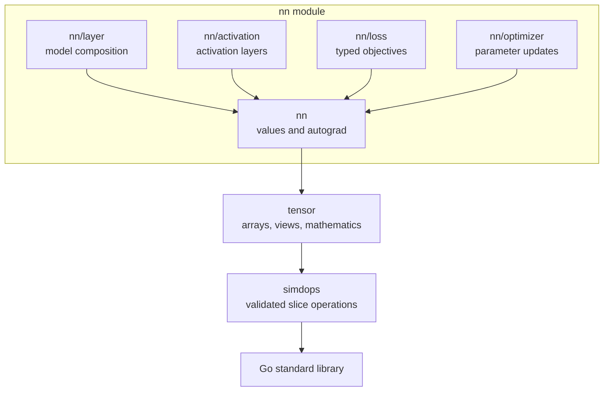
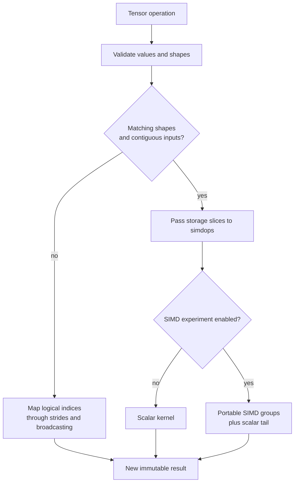
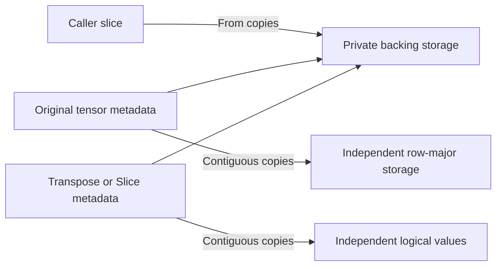

# Architecture

[Documentation](README.md) · [Project overview](../README.md)

goml separates slice kernels, numerical arrays, and differentiation into three Go modules.
Each module can be imported and released independently.
This guide explains their boundaries and the execution model.

## Dependency direction

| Module | Owns | Does not own |
| --- | --- | --- |
| [simdops](../simdops/README.md) | Slice validation, scalar references, optional SIMD arithmetic. | Tensor layouts, graphs, model parameters. |
| [tensor](../tensor/README.md) | Immutable float32 storage, shapes, strides, views, numerical operations. | Gradient tracking, optimizer state, layers. |
| [nn](../nn/README.md) | Differentiable values, graphs, parameters, model composition, objectives, updates. | SIMD dispatch, tensor storage mutation, device backends. |

nn and its subpackages import tensor and never import simdops directly.
Tensor imports simdops for contiguous arithmetic.
The runtime has no third-party dependencies beyond the three-module chain.

## Workspace and versioned modules

The root [go.work](../go.work) selects `simdops`, `tensor`, and `nn`.
There is no root `go.mod`.
The workspace resolves local changes without relative replace directives.

| Manifest | Versioned dependency |
| --- | --- |
| [simdops/go.mod](../simdops/go.mod) | Standard library only. |
| [tensor/go.mod](../tensor/go.mod) | `github.com/bpradana/goml/simdops v0.1.0` |
| [nn/go.mod](../nn/go.mod) | `github.com/bpradana/goml/tensor v0.1.0` |

The version declarations describe the intended first releases.
Those tags are not published yet.
Workspace tests use local modules, while standalone checks require published dependencies.

Subpackages are organizational boundaries inside a module.
The layer, loss, and optimizer packages do not have separate manifests or release tags.
See [releasing](releasing.md) for dependency order and checksum generation.

## Numerical execution

[Tensor arithmetic](../tensor/arithmetic.go) chooses the contiguous fast path.
[Broadcast indexing](../tensor/broadcast.go) handles general layouts.
[Shape helpers](../tensor/internal/shape/) validate layouts and compatibility.

The [simdops API](../simdops/arithmetic.go) validates lengths before writing.
Its [private kernels](../simdops/internal/kernels/) assume those validated lengths.
Complementary build constraints select scalar or experimental arithmetic.

Dot and Sum retain scalar accumulation order.
Max also remains scalar.
The public API contains no experimental vector types.

## Tensor storage and views

Tensor stores private element data, a shape, strides, an offset, and a logical element count.
Contiguous arrays use row-major order.
Views change metadata and share immutable storage.

Shape, Strides, and Data return copies.
Public operations cannot expose writable broadcast storage.
Reshape shares storage only for supported contiguous layouts.

The [tensor contract](tensor-semantics.md) defines zero-sized dimensions,
overflow validation, indexing, and numerical edge cases.

## Graph ownership

A [Value](../nn/value.go) wraps an immutable tensor and optional differentiation state.
Operations compute results immediately.
They record parent lists and backward closures only when tracking is required.

[Backward](../nn/autograd.go) performs these stages:

1. Validate the reachable graph and seed.
2. Build a topological order.
3. Propagate per-pass gradients in reverse order.
4. Accumulate the completed pass into stored gradients.
5. Release saved graph resources and mark operation nodes consumed.

Per-pass gradients are separate from previously accumulated gradients.
This prevents an older contribution from propagating through a new branch twice.

Parameters preserve their leaf identity across iterations.
Updates replace immutable tensor data.
Saved backward operations retain the immutable values needed from their forward pass.

Inference suppresses graph recording throughout the operation path.
There is no global graph registry or global gradient mode.
See [autograd](autograd.md) for lifecycle details and failure contracts.

## Composition boundaries

| Package | Interface | Reason |
| --- | --- | --- |
| [nn/layer](../nn/layer/layer.go) | `Layer`: Forward and Parameters. | Sequential composes different layer implementations. |
| [nn/activation](../nn/activation/doc.go) | Implements the existing Layer contract. | Parameterless layers compose without a duplicate interface. |
| [nn/loss](../nn/loss/loss.go) | `Loss[T]`: Forward. | A training loop can substitute objectives with the same target type. |
| [nn/optimizer](../nn/optimizer/optimizer.go) | `Optimizer`: Step and ZeroGrad. | Training loops can substitute update algorithms. |

The root nn package does not import these subpackages.
Activation implementations live in nn/activation and reuse the Layer contract.
Loss implementations live in nn/loss. MSE composes public nn operations.
Activations and CrossEntropy register validated single-input backward rules through nn.NewOperation.

MSE uses `*nn.Value` targets.
Cross-entropy uses `[]int` class labels.
The generic loss interface preserves this distinction without runtime type assertions.

## Concurrency and performance boundaries

Kernels and matrix multiplication execute sequentially.
There are no global pools, worker engines, or per-element goroutines.

Immutable tensor reads can run concurrently.
Inference can share a model while parameters remain unchanged.
Backward, optimizer updates, and gradient clearing require external synchronization.

The current matrix implementation improves traversal while retaining reference accumulation order.
Blocking, packing, buffer reuse, and parallel workers require benchmark evidence.
The [performance report](performance.md) records the existing baseline.

## Scope

The current architecture supports float32 arrays, first-order eager differentiation, and dense networks.
It has no CGo, GPU backend, device abstraction, JIT, compiled graph engine, or distributed-training layer.

Future numerical types and additional operations must preserve the ownership and dependency boundaries.
Internal extension points do not imply public backend or plugin interfaces.
