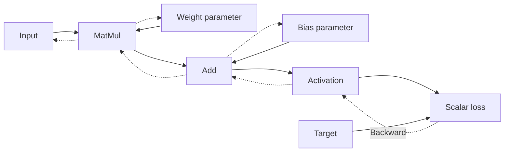
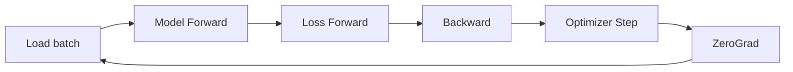

# Autograd and training

[Documentation](README.md) · [nn guide](../nn/README.md)

nn uses eager reverse-mode differentiation.
Each operation computes its result immediately and records backward state only when required.

## Values, constants, and parameters

| API | Result |
| --- | --- |
| `NewValue(data, true)` | A differentiable leaf sharing immutable tensor data. |
| `NewValue(data, false)` | A constant leaf. |
| `NewParameter(data)` | A trainable parameter with stable leaf identity. |
| `Value.Detach()` | A new constant leaf sharing data without the original graph. |
| `Inference(data)` | An input that suppresses tracking throughout subsequent operations. |

A constant input does not disable a parameter's gradients.
An operation records a graph when any operand tracks gradients, unless inference mode is present.

Parameters preserve identity across iterations.
Optimizers replace their immutable tensor data instead of exposing writable tensor storage.

## Forward and backward flow

Backward accepts a scalar output and uses a seed of one.
BackwardWith computes a vector-Jacobian product with an explicit seed.
The seed must have exactly the output's shape and element count.

The reverse traversal combines all contributions to a shared node before propagating them.
Repeated dependencies accumulate rather than overwrite gradients.

For `y = x*x + x*x`, the derivative is `4*x`.
The shared-dependency tests verify that both paths contribute.

## Accumulation and graph consumption

Stored gradients accumulate until ZeroGrad.
Per-pass gradients are separate from those stored values.
A new pass therefore does not propagate an older intermediate gradient again.

A successful backward pass:

1. Validates the seed and reachable graph.
2. Computes the pass in reverse topological order.
3. Adds results to accumulated gradients.
4. Releases saved parents and backward closures.
5. Marks operation nodes consumed.

The implementation commits accumulated gradients after the pass succeeds.
Graph-validation failures leave existing gradients unchanged.

| Attempt | Behavior |
| --- | --- |
| Backward on a differentiable scalar | Accumulates gradients and consumes its operation graph. |
| Backward on a non-scalar | Error. Use BackwardWith with an explicit seed. |
| Backward on an inference or constant result | Error. |
| Backward through a consumed operation | Error. |
| Backward through a shared dependency consumed by another branch | Error. |
| New forward pass using the same parameter leaves | Valid. Gradients accumulate until cleared. |

A consumed value's immutable Data remains readable.
Use Detach if that result should become a constant operand.
Create a new forward pass when gradients should flow through the computation again.

There is no retain-graph option or higher-order differentiation API.

## Differentiation rules

| Operation | Backward behavior |
| --- | --- |
| Add and Sub | Pass gradients with the appropriate sign, then undo broadcasting. |
| Mul and Div | Use saved immutable forward operands, then undo broadcasting. |
| MatMul | Multiply by the corresponding transposed operand. |
| Sum and Mean | Restore reduced dimensions and broadcast over the original input. |
| Reshape | Restore the original shape. |
| Transpose | Apply the inverse axis permutation. |
| Slice | Scatter into the selected input positions. |
| Concat | Split the output gradient along the concatenation axis. |
| Contiguous | Pass the logical gradient through the materialization. |
| Scale | Multiply by the saved scalar factor. |
| ReLU | Pass gradients for positive inputs, with derivative zero at zero. |
| Sigmoid and Tanh | Use their saved forward outputs. |
| Softmax | Apply the per-group Jacobian-vector product using saved probabilities. |

Broadcast gradients sum over expanded leading and singleton dimensions.
The resulting gradient has the original operand's shape.

Saved backward operations capture immutable forward values.
Parameter replacement cannot mutate those saved tensors.
Update parameters only after backward and before the next forward pass.

## Custom operations

NewOperation connects an already-computed immutable result to one input Value.
It accepts a backward function that converts an output gradient into an input gradient.
The result can have a different shape from the input.

The returned input gradient must match the input's exact shape and element count.
Callback errors and incorrect gradient shapes fail Backward before the pass accumulates gradients.
Capture immutable forward tensors when a rule needs saved values.

Tracked inputs require a backward function.
Untracked and inference operations do not retain that function.
Custom operations follow the same graph-consumption rules as built-in operations.

The [operation constructor](../nn/operation.go) provides this boundary without exposing graph fields.
Activation layers use it to keep their calculations and derivatives inside nn/activation.
CrossEntropy uses the same boundary for its calculation and derivative in nn/loss.

NewMultiOperation accepts a list of inputs and one backward function.
The callback returns one gradient tensor per input, in input order.
Every gradient must match its corresponding input's shape and element count.
Repeated input values accumulate their separate contributions.
The constructor copies the input list and preserves nn's inference and graph-consumption rules.
Concat and LayerNorm use this multi-input boundary.

The development layers also use differentiable Slice, Concat, Contiguous, and Scale operations.
RNN and LSTM record their recurrent dependencies explicitly.
Detach a carried state when training should stop gradients at a chunk boundary.
See [layer state semantics](layers.md#recurrent-layers-and-state) for shapes and ownership.

## Typed losses

The [loss package](../nn/loss/loss.go) exposes a single-method interface, `Loss[T]`.
Construct its implementations with NewMSE and NewCrossEntropy.

| Loss | Prediction | Target | Reduction |
| --- | --- | --- | --- |
| MSE | Nonempty Value of any supported shape. | Value with exactly the same shape. | Mean over all squared element errors. |
| CrossEntropy | Finite logits `[batch,classes]` with positive dimensions. | `[]int` with one label per row. | Mean over rows. |

MSE can differentiate both prediction and target.
It rejects broadcasting between them.

CrossEntropy requires labels in `[0,classes)`.
It uses shifted log-sum-exp rather than naive softmax followed by log.
Only logits are differentiated.
Backward uses the labels supplied during Forward, even if the caller later changes the label slice.

MSE composes public differentiable operations.
CrossEntropy owns its stable calculation and registers a backward rule through NewOperation.
Both implementations live in nn/loss. Graph internals remain private to nn.

## Training lifecycle

Step retains gradients after it replaces parameter values.
Call ZeroGrad before accumulating the next iteration's gradients.
To accumulate across several batches, delay Step and ZeroGrad until the intended accumulation is complete.

SGD uses gradient descent without momentum.
Adam owns first and second moments and applies bias correction.
Parameters without gradients are skipped.
Adam advances a parameter's counter only when that parameter has a gradient.

## Inference and concurrency

Inference inputs suppress graph recording throughout the operation path.
Sequential.Predict creates such an input and returns a plain tensor.
Inference retains no saved parent lists or backward closures.

Independent inference calls can read a model while its parameters remain unchanged.
Backward, optimizer steps, gradient clearing, and concurrent training require external synchronization.

There is no global graph registry or global gradient-mode switch.
The caller owns model and training lifetimes.

## Verification

Finite-difference tests cover numerical operations and loss gradients.
Exact tests cover accumulation, shared dependencies, consumed graphs, and explicit seed shapes.
The [validation guide](testing.md) describes tolerances, reference calculations, and remaining evidence.

## GPU gradients

The graph remains eager and independent of backend implementation details.
Backward creates its seed on the output device and performs differentiation through tensor operations.
Queued GPU errors are synchronized before gradient commit or graph consumption.

Leaf gradients own independent handles on every device and accumulate across forward scopes until ZeroGrad.
Intermediate gradients follow their forward scope's lifetime. Grad handles are borrowed until clearing or replacement.
Use a batch scope through Forward, Backward, optimizer Step, and ZeroGrad, then close the scope.
Move parameters before creating an optimizer. Adam owns device moments and provides Close to release them.
See [GPU training](gpu.md#neural-networks-and-gradients) for lifecycle and checkpoint compatibility.

## Saved parameter values

Each recorded operation retains the parameter generations used by its forward
pass. Updating a parameter preserves its identity and keeps older generations
alive while a graph still needs them. Successful backward releases those graph
references; retired tensor handles then close. Failed backward preserves the
graph for retry, and abandoned-graph cleanup is a safety net.

`Value.Data()` exposes a borrowed parameter handle. External callers use
`Tensor.Retain` when they need an independent reference across updates.
Explicit training and parameter transfers still require caller synchronization.
