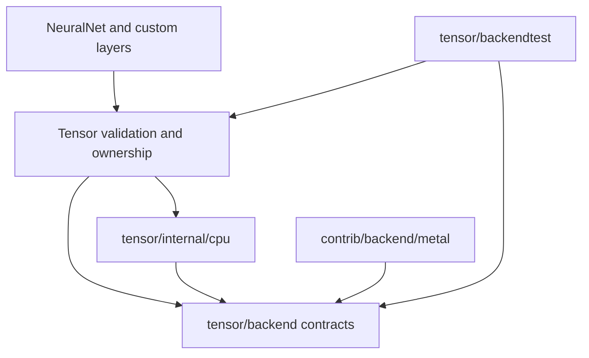
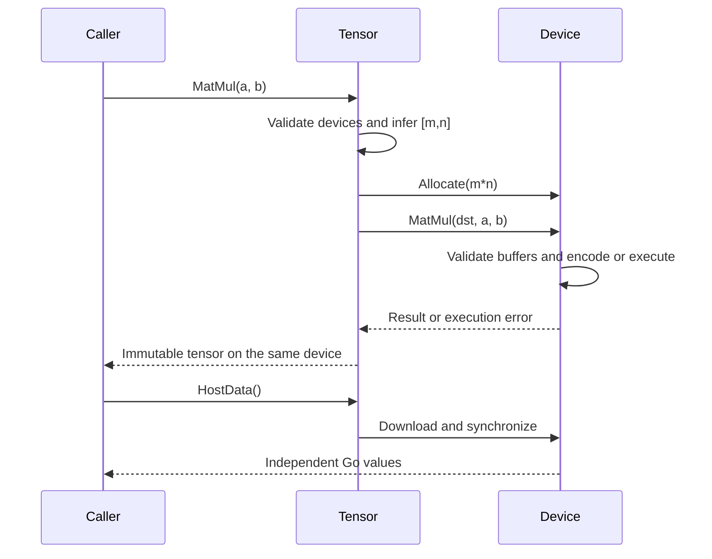

# Backend contract

Goml separates tensor mathematics from execution and storage. The contracts live in
[`tensor/backend`](../tensor/backend), inside the Tensor module. They import neither
Tensor nor NeuralNet. A backend implements `Device` and the numerical capabilities
it supports. There is no registry, device-name switch, or automatic CPU fallback.

## Execution boundary

Tensor validates live operands, device compatibility, mathematical shapes,
broadcasting, reduction axes, and output sizes. It allocates the immutable result,
selects a capability, and invokes one backend operation. Backends check buffer
ownership, physical bounds, output overlap, and hardware constraints. They retain
resources needed by asynchronous execution before returning.

## Device and buffer

`Device` represents one execution context, with a stable `ID()` distinct from its
human-readable `Name()`. Two contexts on the same GPU are different devices.
`Tensor.Device()` always returns a device for a constructed tensor. `tensor.CPU()`
returns the shared stateless CPU context; closing that context is harmless.
Closing an owned context, such as Metal, waits for pending work and invalidates its
buffers. Repeated `Close()` calls are harmless.

`GCManagedBuffer` is an optional lifetime optimization for stateless Go-memory
allocations whose storage and bookkeeping are entirely garbage-collected. Tensor
omits an extra cleanup registration for those buffers. CPU implements it; native
resources and allocation registries must not claim it. Explicit Close semantics
remain unchanged.

`Allocate(elements)` returns an opaque Float32 `Buffer`. Its length is immutable.
Uninitialized memory is permitted: initialization is an explicit `Fill` or upload.
A buffer reports its owner through `DeviceID()`. Implementations also verify actual
ownership; matching a caller-provided ID is insufficient. `Valid()` reports closed
storage or an owning device that has shut down. `Buffer.Close()` is idempotent.

`Upload` and `Download` copy exactly the allocation length. Neither retains or
returns a borrowed Go slice. Upload must order host writes safely against queued
work. Download waits for preceding work and propagates asynchronous errors.
`Synchronize()` is an explicit execution barrier.

## Views and lifetimes

`View` borrows shape, nonnegative element strides, and an element offset over a
buffer. Rank-zero views contain one element. Dimensions may be zero. Zero-size
views do not dereference storage. Negative dimensions, overflow, negative strides,
and out-of-bounds nonempty layouts are invalid.

- `Validate()` checks liveness and physical bounds.
- `ValidateOutput()` additionally rejects overlapping writes.
- `ValidateLayout(elements, writable)` performs those layout checks without calling
  `Buffer.Valid()`. A backend can use it after checking ownership and liveness under
  its device lock, avoiding reentrant locking.

Standard contiguous, transposed, and sliced outputs can be proven nonoverlapping.
Exotic overlapping or ambiguous layouts are rejected. A backend may require more
restricted output layouts and report `ErrUnsupported`. Metal numerical destinations
are complete contiguous allocations; `Copy` also supports strided scatter.

A view does not own its buffer. Metadata slices are borrowed only during the call.
An asynchronous backend copies any metadata it retains. It retains physical buffer
resources until commands finish, even if the caller closes the logical buffer.

Tensor owns storage references independently of backend buffers. `Retain`,
`Reshape`, `Transpose`, and `Slice` create independent handles sharing immutable
storage. Closing one handle does not invalidate another. Closing the final live
handle permits physical release. Allocation cleanup is a garbage-collection safety
net; explicit `Close` and `Scope` are the primary lifetime boundaries.

`Scope.To` shares same-device storage through an independent handle, or explicitly
transfers between devices. Results inherit their input scope. `Keep()` detaches a
result before scope closure. Complete all goroutines using scoped handles before
closing the scope. Closing a scope does not itself fence the GPU; pending commands
retain their native resources.

## Optional capabilities

Each interface is independent. Inference-only implementations can omit gradients.
Unknown typed operation values and unsupported configurations wrap
`backend.ErrUnsupported`.

| Capability | Responsibility |
| --- | --- |
| `UnaryBackend` | Exp, Log, Sqrt, activations, and activation derivatives |
| `BinaryBackend` | Add, Sub, Mul, Div with trailing-dimension broadcasting |
| `ScalarBackend` | Scale, AddScalar, and upper-triangle masking |
| `ReductionBackend` | Sum, Mean, and Max over distinct selected axes |
| `MatMulBackend` | `[m,k] × [k,n] → [m,n]`, including empty dimensions |
| `FillBackend` | Explicit value initialization |
| `CopyBackend` | Logical materialization and strided scatter |
| `ConcatBackend` | Optional fused concatenation; Tensor can also compose Copy |
| `ConvolutionBackend` | NCHW cross-correlation with optional bias |
| `ConvolutionBackwardBackend` | Input and flattened weight derivatives |
| `PatchBackend` | Existing Im2Col/Col2Im training kernels, not required by native convolution |
| `PoolBackend`, `PoolBackwardBackend` | Floor-size NCHW max pooling and derivatives |
| `ResizeBackend`, `ResizeBackwardBackend` | Integer-scale nearest, bilinear, and bicubic interpolation |
| `FiniteBackend` | On-device finite-value validation; a small status read is allowed |
| `SubScaledBackend` | Optional fused immutable `a-factor*b` update |
| `HostAdamBackend` | Existing synchronous fused Adam with optimizer-owned host moments |
| `HostAccess` | Host-native logical reads and indexing without accelerator transfers |

The CPU backend implements these capabilities using the existing SIMD arithmetic,
blocked MatMul, tiled convolution, and optimized traversal kernels. Dispatch occurs
once per operation, never once per element. Metal preserves its native shaders,
MPS MatMul, MPSGraph convolution, spatial kernels, and ordered command queue.

`HostAccess` is deliberately opt-in. Mapped accelerator memory does not make a
backend host-native. NeuralNet uses this capability to select its existing host
algorithms; other devices compose Tensor operations. Adam selects its fused host
capability independently and otherwise keeps tensor moments on the device.

## Mathematical semantics

All tensors contain Float32 elements. Contiguous storage is row-major. Element-wise
operations preserve shape or use trailing-dimension broadcasting. Dimensions must
match or one must equal one, including the documented zero-sized cases. Arithmetic
uses IEEE special values; NaNs propagate through reductions and activations.
Reduction dimensions are removed. No axes means all axes; duplicate or invalid
axes fail. Empty sums are zero; empty mean/max groups fail.

Convolution uses NCHW inputs, flattened weights `[in*kernel*kernel,out]`, optional
bias `[out]`, square kernels, equal spatial strides, and symmetric zero padding.
Pooling padding is negative infinity; finite ties and NaNs select the first source
in row-major order. Resize uses half-pixel coordinates with `align_corners=false`;
bicubic interpolation has coefficient `-0.75`.

Backends need not promise bit-identical reductions or fused products. Shared tests
use absolute-plus-relative Float32 comparisons: ordinary arithmetic around
`1e-5`–`3e-5`, MatMul `2e-4`, and convolution/gradients `3e-4`–`4e-4`. Tests compare
against independent references. Model parity has separate workload-specific
limits in the GPU validation guide. Document any additional hardware constraints;
Metal currently limits rank to eight and indexing to 32 bits.

## Errors and concurrency

| Sentinel | Meaning |
| --- | --- |
| `ErrUnsupported` | Missing capability, operation kind, layout, or hardware configuration |
| `ErrDeviceMismatch` | Foreign buffers or incompatible execution contexts |
| `ErrClosed` | Closed tensor handle, buffer, or owned context |
| `ErrInvalidView` | Invalid physical bounds, transfer length, or overlapping output |
| `ErrAllocation` | Invalid allocation request or allocation failure |

Wrap these errors with operation and native details; callers use `errors.Is`.
A failed supported operation is not reported as unsupported. Never return a
zero-filled successful result after a native failure. Tensor releases output
allocations when dispatch fails.

Device methods support concurrent callers using independent buffers. Callers
coordinate overlapping writes, device transfers, model updates, and training.
The CPU executes synchronously. Metal serializes command encoding on one ordered
queue and reports deferred errors at synchronization/download/shutdown. Device
shutdown must not race live model execution without caller coordination.

## Validation and extension

Run the mandatory Device suite and each claimed capability suite from
[`tensor/backendtest`](../tensor/backendtest). Tests leave the supplied device open;
`RunShutdown` deliberately closes an owned context and runs last. The suite covers
numerical references, invalid buffers, transfers, independent view ownership,
scopes, queued resource retention, and concurrent independent allocations.

See [Extending backends](extending-backends.md) for a compilable MatMul-only example
and [GPU development](gpu.md) for Metal installation, validation, and benchmarks.
CUDA and ROCm remain unimplemented source reservations.
