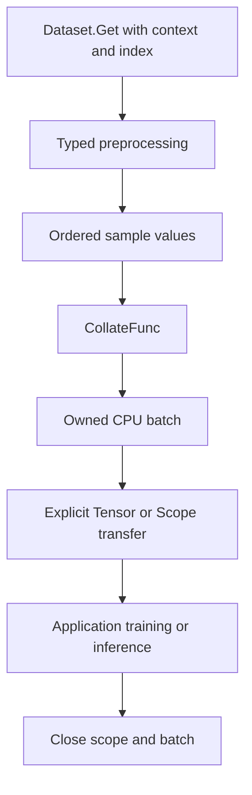

# Datasets and DataLoader

[Data module](../data/README.md) · [MNIST application](../nn/examples/mnist/README.md)

The data module separates sample access, preprocessing, collation, and model
execution. It uses only Tensor and the standard library. Normal nn training
remains independent of data; a separate application imports both libraries.

## Choose a dataset

| Input | API | Host storage |
| --- | --- | --- |
| Existing input Tensor and labels | data.NewClassificationDataset | One copied logical snapshot and labels. |
| Existing input/target Tensors | data.NewRegressionDataset | One copied snapshot of each Tensor. |
| Local MNIST | mnist.Open / OpenContext / OpenFiles | Validated byte images and labels. |
| Numerical CSV | csvdata.OpenClassification / OpenRegression | Parsed finite feature and target arrays. |
| JPEG/PNG class directories | imagefolder.Open | Sorted paths, class names, and an open rooted directory. |
| Application-specific samples | Implement Dataset[T]. | Defined by the application. |

All built-ins check bounds, respect Get cancellation, and support concurrent
Get calls. Array, MNIST, and CSV datasets leave no files open. ImageFolder has an
idempotent Close; finish readers before closing it. Samples own their returned
slices and can be mutated without changing subsequent reads.

## Implement a custom dataset

The [complete custom program](../data/examples/custom/main.go) implements
Dataset[sentence] using only the public package. Its sample contains a string and
variable-length token IDs. Its custom collator returns copied text/token slices.
It neither registers a type nor requires Tensor values.

```go
type Dataset[T any] interface {
	Len() int
	Get(context.Context, int) (T, error)
}
```

Keep Len stable for the duration of an iteration. Get should check context before
work, periodically during I/O, and before returning expensive decoded values.
Return useful errors for negative/out-of-range indices and file failures. Do not
reuse a single mutable buffer for every sample in the same batch. The caller
must keep samples valid until the collator completes.

A source may expose its own concrete Close method when it owns resources. Close
is not part of the base interface. Streaming sources with unknown length need a
separate contract; they should not fabricate indexed access.

## Collate and iterate

The collator type is `func([]S) (B, error)`. It can produce any concrete batch B.
Built-in collators produce `*ClassificationBatch` or `*RegressionBatch`. Their
input shapes must match, labels are nonnegative integers, and regression targets
have a separately validated fixed shape. Scalar per-sample shapes are supported.

```go
loader, err := data.NewLoader(dataset, collate, data.LoaderOptions{
	BatchSize: 64,
	Shuffle:   true,
	DropLast:  false,
	Seed:      42,
})
if err != nil {
	return err
}
```

Batches(ctx, epoch) is a range-over-function sequence. With shuffling disabled,
indices remain in dataset order and no permutation slice is allocated. Shuffling
uses an independent PCG and Fisher–Yates permutation per iteration, derived from
Seed and epoch. It does not change source contents. The final short batch is
returned unless DropLast is true. Empty sources produce no successful yields.

Every successfully yielded batch belongs to the application, including when the
loop breaks early. Collators must clean partial resources on failure. The loader
cannot infer how to close an arbitrary generic batch. It stops after one error
and propagates context/read/collation errors with standard Go wrapping.

No goroutines or channels are created. An early break stops further reads, and
there are no prefetched batches to release. Custom source/collator concurrency
rules apply if multiple iterations are consumed concurrently.

## Compose typed preprocessing

ImageFolder returns CHW values after decoding. Configure an explicit Resize or
CenterCrop to make variable input sizes compatible with collation. Normalize
uses per-channel copied finite statistics and positive standard deviations.
All built-in numerical transforms return new sample slices and preserve labels.

Use `data.Map(source, apply)` for arbitrary typed transforms; Compose chains
same-type Func[T] values. Function types keep error paths visible without dynamic
maps or reflection. Random augmentations are not included in this release.



## CPU and Metal

The Dataset and DataLoader APIs do not initialize accelerators. Build one CPU
batch before uploading. Call Tensor.To(device) for an independent device handle,
or Scope.To for per-batch temporary ownership. Never upload each individual image.

The [MNIST application](../nn/examples/mnist/main.go) keeps training logic in a
batch helper. It closes the temporary scope on every return, then the caller
closes the CPU batch whether training succeeded or failed. Model parameters and
Adam moments stay on the selected device. GPU shutdown remains explicit.

The ordinary application compiles without CGo and accepts CPU only. The opt-in
`metal` build tag adds the Metal selector in that application's module. The data
and nn library modules do not import it. `mise run test:data:metal` exercises batch
ownership, explicit transfers, and both Dense/CNN training on real Apple hardware.

Tensor-backed dataset constructors reject accelerators, even if the hardware uses
unified memory. Explicitly call ToCPU before creating a host dataset. Checkpoint
serialization and host reads remain explicit Tensor/application operations.

## Modules, validation, and releases

`data/go.mod` uses the published Tensor v0.3.0 dependency. Run
`mise run test:standalone:data` to verify without workspace resolution.
No relative replace directives or unpublished library dependencies are committed.

The MNIST application is a nested development module. Its initial data requirement
can be added only after data/v0.1.0 is published. Until then, the workspace supplies
the local module. The application has no independent release tag. See the
[release guide](releasing.md) for the dependency bootstrap sequence.

Tests generate local IDX, gzip, CSV, JPEG, and PNG fixtures. Numerical, shuffle,
ownership, cancellation, and concurrent-read checks run in ordinary CPU CI.
The [performance report](performance/data.md) records measured costs and limits.
