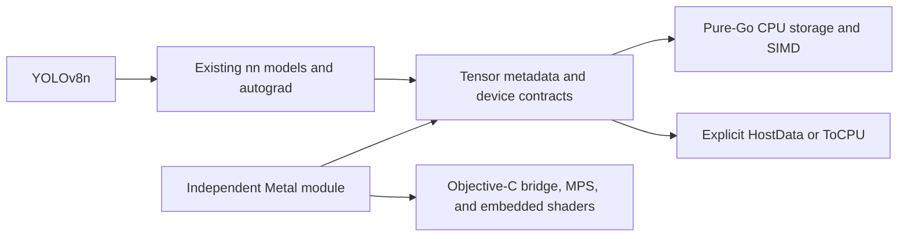
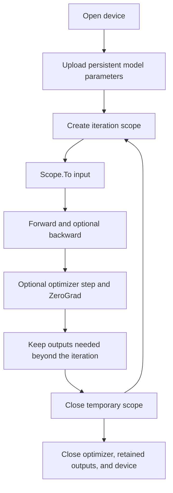

# GPU execution

[Documentation](README.md) · [Metal backend](../contrib/backend/metal/README.md) · [Measurements](performance/metal.md)

Metal adds explicit GPU execution to tensor v0.3.0, nn v0.5.0, and YOLO v0.3.0.
CPU execution remains the default and requires no CGo or Apple framework.
CUDA and ROCm contain documentation and module manifests only. They are outside go.work and ordinary CI.

## Dependency direction



Tensor owns the focused device, arithmetic, layout, convolution, spatial, and validation contracts.
Metal implements them. Tensor and nn do not import Metal.
Metal's runtime module depends only on tensor and indirect simdops.
The nested Metal examples module supplies nn and YOLO integration workloads without adding those backend dependencies.

## Tensor migration

| CPU API | GPU behavior | Explicit alternative |
| --- | --- | --- |
| From, Zeros, Ones, Rand, Randn | Construct CPU tensors as before. | To(device), Scope.To, FullLike, or FromLike. |
| Device | Returns nil for CPU. | Returns the owning device instance for GPU storage. |
| Data | Panics for GPU storage. | HostData downloads a logical copy and returns errors. |
| At | Returns an error for GPU storage. | ToCPU, then At. |
| Contiguous | Panics for GPU storage. | MakeContiguous allocates on the current device and returns errors. |
| String | Reports device and bounded shape metadata. | HostData for explicit value inspection. |
| Reshape, Transpose, Slice | Share storage through independent leases. | Close each retained GPU lease or use a Scope. |

Arithmetic preserves the input device. Mixing CPU and GPU tensors or separate device instances returns an error.
GPU mathematical operations never silently download values or invoke CPU numerical kernels.
Cross-device To explicitly stages through host memory. Same-device To creates an independent storage lease.
CPU To(nil) and HostData return copies.

Metal supports strided inputs, trailing-dimension broadcasting, and up to eight dimensions.
The kernels use 32-bit element indexing. Native allocation limits can be lower.
CPU tensors retain their existing rank and allocation limits.
GPU Im2Col and Col2Im return explicit errors. Conv2D uses native MPSGraph convolution instead.

## Explicit lifetimes



A tensor contains immutable metadata and either Go-managed data or a GPU storage lease.
Views increment the underlying allocation's reference count. Closing one lease preserves other views.
Commands retain native resources until completion. Device.Close waits before invalidating remaining buffers.
Explicit lease cleanup waits for concurrent Go cleanup callbacks to finish releasing their references.

Operations inherit a temporary scope from their inputs. Scope.Close releases every unkept lease.
Keep preserves one output lease beyond the scope. The caller then owns its Close responsibility.
A view of a kept tensor has its own lease and lifetime.
Synchronize goroutines before closing a shared scope or updating a model.

Native allocations, saved graph tensors, and optimizer state require explicit lifetime boundaries.
Go cleanup callbacks are a safety net. They do not replace scope and device cleanup.
Stats reports tracked live bytes, peak bytes, and open buffer handles.
Pending commands remain included in byte accounting. MPS-private workspace allocations are excluded.

## Neural networks and gradients

Transfer parameters before constructing an optimizer:

```go
if err := nn.ToDevice(model.Parameters(), device); err != nil {
    return err
}
```

The transfer deduplicates shared parameters and stages all values before committing.
Failures preserve original values and gradients. Success preserves parameter identity and clears gradients.
Use a fresh optimizer after changing devices.

Wrap each batch in a scope. Keep that scope open through Backward and Step.
Clear gradients before closing the scope. GPU leaf gradients own independent leases and can
accumulate across scopes until ZeroGrad. Intermediate gradients share the forward scope's lifetime.
Grad and GPU parameter Data handles are borrowed. Retain an independent view before clearing or updating them.

Backward seeds and arithmetic stay on the output device. Shared dependencies accumulate normally.
Backward waits for queued GPU errors before committing gradients or consuming a graph.
Parameter updates follow Backward, preserving saved forward values through differentiation.
Inference uses nn.Inference to suppress graph recording.

SGD stages parameter results before synchronization and commit.
Adam also keeps first and second moments on the device and stages their replacement.
One optimizer step synchronizes once after preparing its parameter set.
Adam.Close releases device moments. It does not close model parameters.

Cross-entropy validates finite logits through a four-byte GPU status flag.
This validation is a synchronization boundary. It does not download the logits array.
GPU arithmetic otherwise follows Float32 special-value behavior and documented reduction tolerances.

## Checkpoints and YOLO

Checkpoint encoding explicitly downloads parameter values through HostData.
The file format is unchanged. Native pointers, queues, devices, and optimizer moments are excluded.
Loading a complete network constructs CPU parameters and requires no Metal installation.
LoadWeights stages transfers onto existing parameter devices before replacing values and clearing gradients.

YOLO.Load always starts on CPU. Model.ToDevice uploads weights once.
GPU Forward owns a temporary activation scope and returns three retained GPU heads.
Callers close those heads. Detect manages this lifecycle automatically, including input upload and final downloads.
Postprocess exposes CPU decoding, NMS, and original-coordinate restoration separately for staged pipelines.
It explicitly downloads GPU heads when supplied with them.

## Validation by implementation phase

| Phase | Main files | Evidence and limits |
| --- | --- | --- |
| Audit and contract | tensor/device.go, storage.go, transfer.go | CPU slice assumptions identified across activations, spatial layers, loss, checkpoint, and optimizer code. Device imports point toward tensor. |
| Scaffolding | contrib/backend/{metal,cuda,rocm}/go.mod and READMEs | Only Metal joins the active workspace. CUDA and ROCm compile as documentation-only packages. |
| Storage | tensor storage, transfer, and view files | CPU ownership tests pass. GPU views survive parent Close. Scoped results and pending commands release correctly. |
| Native foundation | Metal device.go, native files, metal.h, kernels.metal | Actual M1 Pro initialization, transfers, shared-buffer ownership, shader compilation, concurrent scopes, and pending shutdown pass. |
| MatMul | Metal compute.go and MPS bridge | Rectangular, irregular, transposed, singleton-stride, and zero-dimension parity passes. Repeated timings separate transfers from resident work. |
| Numerical operations | Metal compute.go, spatial.go, validation.go | Arithmetic, broadcasting, reductions, all interpolation modes, pooling, finite validation, malformed views, and explicit errors pass. |
| Inference | nn device paths and Metal gradient tests | Dense, RNN, LSTM, native convolution, normalization, causal attention, positional encoding, Softmax, and transformer forward/backward match CPU. |
| YOLO | contrib/nn/yolo device/model/detect files | 320 and 640 raw-head and detection parity validated against CPU. CPU also passes the existing PyTorch reference workflow. |
| Training | nn autograd, parameter, optimizer, and checkpoint files | SGD and Adam match CPU updates. CNN loss falls from 0.64618 to 0.000369. Thirty consecutive 60-step runs retain a stable allocation baseline. Portable checkpoint restoration passes. |
| Stabilization | mise tasks, Metal workflow, release configuration, and guides | CPU and GPU quality gates are separate. Final standalone downstream checks require publication of compatible upstream tags. |

The [performance report](performance/metal.md) records hardware, exact workloads, measured results, and reproduction commands.
Numerical parity is not a dataset-level accuracy claim. Native Go race tests do not prove absence of every native driver fault.
The tests cover closed-device errors and native failure propagation without deliberately provoking GPU hardware faults.

## Development and release

Ordinary CPU CI runs workspace tests on Linux. It does not require CGo, macOS, or a GPU.
Standalone tests are release gates after dependencies become public.
The manual Metal workflow requires a self-hosted runner labeled self-hosted, macOS, ARM64, and metal.
It does not assume a hosted macOS runner exposes a usable GPU.
YOLO artifact tests remain opt-in and require local converted weights and reference files.

Release tensor/v0.3.0, nn/v0.5.0, contrib/nn/yolo/v0.3.0, and contrib/backend/metal/v0.1.0 in dependency order.
Metal itself only requires the tensor release. The full integration suite also needs nn and YOLO.
Generate real checksums and run GOWORK=off validation after each upstream publication.
The examples module and CUDA/ROCm reservations have no release tags.
See the [release procedure](releasing.md).
