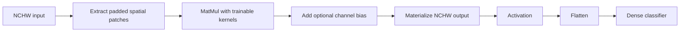
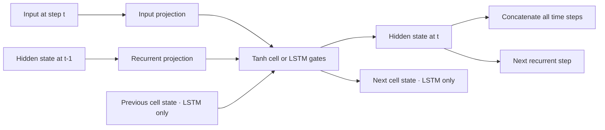
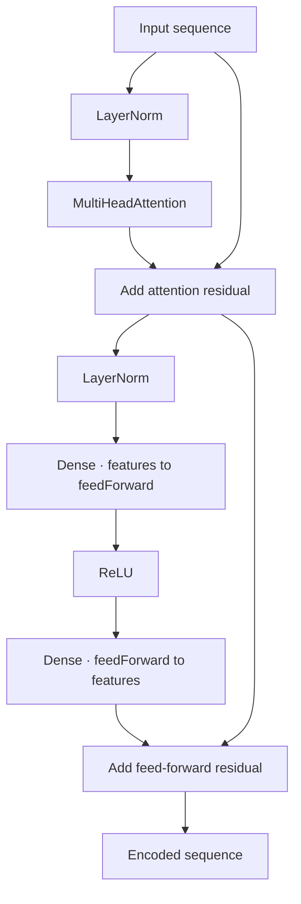

# Neural network layers

[Documentation](README.md) · [nn API](../nn/README.md) · [Examples](../nn/examples/README.md)

This guide describes the spatial, recurrent, attention, and transformer layers in nn v0.4.0.
They use tensor v0.2.0 for numerical kernels and require no external model runtime.

## Choose a layer

All layers implement `layer.Layer` and compose with `layer.NewSequential`.
Constructors return errors when dimensions or random generators are invalid.
Stateless constructors return their concrete layer directly.

| Constructor | Input | Output | Purpose |
| --- | --- | --- | --- |
| `NewConv2D(in, out, kernel, stride, padding, bias, rng)` | `[batch,in,height,width]` | `[batch,out,outH,outW]` | Square spatial cross-correlation. |
| `NewFlatten()` | `[batch,d1,...]` | `[batch,d1*...]` | Convert images to Dense input. |
| `NewRNN(in, hidden, rng)` | `[batch,time,in]` | `[batch,time,hidden]` | Tanh recurrence. |
| `NewLSTM(in, hidden, rng)` | `[batch,time,in]` | `[batch,time,hidden]` | Gated recurrence with a cell state. |
| `NewLastStep()` | `[batch,time,features]` | `[batch,features]` | Select a sequence's final output. |
| `NewMultiHeadAttention(features, heads, causal, rng)` | `[batch,time,features]` | Same shape. | Self-attention with optional causal masking. |
| `NewLayerNorm(features, epsilon)` | `[...,features]` | Same shape. | Normalize the final dimension with learned scale and bias. |
| `NewPositionalEncoding()` | `[batch,time,features]` | Same shape. | Add fixed sinusoidal positions. |
| `NewTransformerEncoder(features, heads, feedForward, rng)` | `[batch,time,features]` | Same shape. | Pre-normalized encoder block. |

`activation.NewSoftmax(axis)` normalizes a selected dimension without changing shape.
Axes are nonnegative. The normalization dimension must be nonempty.
Softmax subtracts the group maximum before evaluating exponentials.

## Convolution

Conv2D uses NCHW layout: batch, channel, height, width.
The operation is cross-correlation, which follows the usual neural network convolution convention.
The kernel is not reversed.



For each spatial dimension, the output size is `floor((input + 2*padding - kernel)/stride) + 1`.
The padded input must be at least as large as the kernel.
Channels, kernel, and stride must be positive. Padding must be nonnegative.
Empty batches are supported. Empty spatial dimensions are rejected.

Parameters returns the kernel matrix `[in*kernel*kernel,out]`, followed by optional bias `[out]`.
Kernel rows follow input-channel, kernel-row, kernel-column order.
The flattened matrix uses Dense's Xavier initialization.

Patch extraction saves geometry for backward.
Overlapping patches add their gradient contributions into the original image positions.
The matrix product and bias use the existing differentiable operations.

Training retains one full patch matrix for weight differentiation. Inference
uses 64-position patch tiles and writes NCHW output and bias directly. Numerical
extraction and scattering live in tensor; parameter ownership and graph wiring
remain in nn/layer.
Conv2D does not support dilation, groups, or asymmetric padding.
Use the separate MaxPool2D layer for pooling.
Training on large images can still require substantial temporary memory.

## Pooling and interpolation

NewMaxPool2D(kernel, stride, padding) computes NCHW spatial maxima with floor output sizes and negative-infinity padding.
Padding must lie in [0,kernel/2]. Finite ties select the first input; the first NaN propagates.
Backward sums contributions from overlapping windows.

NewUpsample2D(scale, mode) enlarges both spatial axes by a positive integer scale.
Choose layer.Nearest, layer.Bilinear, or layer.Bicubic explicitly.
Bilinear and bicubic use half-pixel coordinates, align_corners=false, and replicated edge pixels.
Bicubic uses coefficient -0.75 and may overshoot the input range. No antialias filter is applied.
All modes differentiate with respect to their input.

SiLU, MaxPool2D, and Upsample2D round-trip through checkpoint.Save and Load.
See the [layer package guide](../nn/layer/README.md) for composition examples and the [YOLO module](../contrib/nn/yolo/README.md) for their pretrained inference use.

## Recurrent layers and state

RNN and LSTM use batch-first sequences.
The time dimension must be positive. They support empty batches.
Forward returns every hidden output and starts each call from zero state.
Neither layer stores mutable sequence state between calls.



RNN computes `h[t] = tanh(x[t]W + h[t-1]U + b)`.
Parameters returns input weight, input bias, and recurrent weight.

LSTM packs its gates in input, forget, candidate, output order.
The input, forget, and output gates use Sigmoid. The candidate uses Tanh.
It computes `c[t] = forget*c[t-1] + input*candidate` and `h[t] = output*tanh(c[t])`.
Forget bias starts at one. Other biases start at zero.
Parameters returns packed input weight, packed bias, and packed recurrent weight.

Use these methods when processing a sequence in chunks:

```go
sequence, hidden, err := recurrent.ForwardState(input, initialHidden)
sequence, hidden, cell, err := memory.ForwardState(input, initialHidden, initialCell)
```

Each state has shape `[batch,hidden]`. A nil initial state means zero.
Returned states remain connected to the graph during training.
Pass detached states into the next chunk to truncate differentiation.
After backward consumes a graph, detach a saved state before reusing its data.

Inference inputs suppress state tracking, including tracking on supplied initial states.
There is no bidirectional recurrence, stacked-layer constructor, or automatic padding mask.
Stack recurrent layers explicitly through Sequential when their feature dimensions match.

## Attention and transformer blocks

MultiHeadAttention uses separate query, key, value, and output projections.
Features must be divisible by the positive head count.
Batch and time dimensions must be positive.
Each head computes `softmax(QKᵀ/sqrt(headWidth))V`.

Causal mode replaces future logits with negative infinity.
Masked positions receive zero probability and zero gradient.
The causal mask always includes the current position.
Bidirectional attention includes every position in the sequence.

TransformerEncoder uses bidirectional attention and two residual paths:



LayerNorm uses population variance and trainable per-feature scale and bias.
Its epsilon must be finite and positive. The encoder uses `1e-5`.
Normalization accumulates its mean, variance, and intermediate derivatives in float64.
Tensor storage and outputs remain float32.

PositionalEncoding adds sine on even features and cosine on odd features, using base 10000.
Add it before the first encoder block when sequence position matters.
The encoder itself does not add position information.

These blocks provide encoder building components, not a pretrained language model.
There is no token vocabulary, embedding layer, decoder, cross-attention, padding mask, dropout, or generation cache.
Attention materializes a time-by-time matrix for every batch and head.
Its memory requirement grows quadratically with sequence length.

The attention and position formulas follow [Attention Is All You Need](https://arxiv.org/abs/1706.03762).
The encoder uses pre-normalization as shown in its diagram.

## Ownership, inference, and validation

Forward operations preserve input tensors and allocate outputs or immutable views.
Parameters retain identity through optimizer updates.
Inference uses the same mathematical path without retaining graph dependencies.

Finite-difference tests cover inputs and every trainable parameter of all four model families.
Weighted output seeds exercise normalization and attention derivatives.
Separate reference tests check convolution overlap, recurrent equations, attention heads, and positional values.

The examples train only on tiny generated datasets.
Their convergence checks establish a working training path, not generalization or real-dataset accuracy.
See [testing](testing.md) and [performance](performance.md) for evidence and measurement limits.
