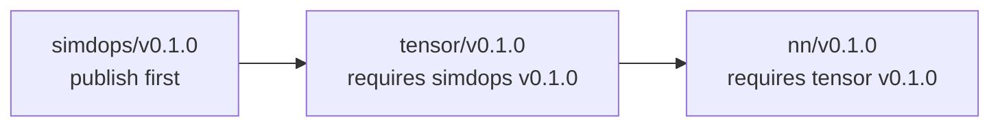

# Releasing

[Documentation](README.md) · [Development](development.md)

Each module has an independent version and a Go subdirectory tag.
This procedure publishes dependencies before their consumers.

**Current state:** the repository and v0.1.0 tags are not published.
Local workspace checks can pass before standalone dependency checks.
Documentation changes and local commits do not publish a release.

## Version and dependency order



| Module | Tag | Required upstream release |
| --- | --- | --- |
| simdops | `simdops/v0.1.0` | None. |
| tensor | `tensor/v0.1.0` | `simdops/v0.1.0` |
| nn | `nn/v0.1.0` | `tensor/v0.1.0` |

Layer, loss, and optimizer packages share the nn module's version.
Do not create separate tags for those subpackages.

## Prepare the candidate

Run from the repository root:

```sh
mise install --locked
mise run fmt
mise run ci
mise run test:simd
mise run test:fuzz
mise run build:portable
mise run bench:record
```

Review these contracts before tagging:

| Area | Review |
| --- | --- |
| Public API | Names, target types, shape constraints, errors, and compatibility. |
| Memory | Construction copies, view sharing, parameter replacement, and gradient ownership. |
| Numerical behavior | Empty inputs, NaN, infinity, overflow, and comparison tolerances. |
| Dependencies | Actual versioned requirements and no relative replace directives. |
| Examples | Compilable programs, convergence checks, and explicit MNIST data setup. |
| Evidence | Native target tests, reproducible benchmarks, and accurate documentation. |
| Release files | Changelog, module READMEs, license, manifests, and generated checksums. |

Update the validation status for the candidate.
Cross-compilation is not native target execution.
MNIST fixtures do not establish real-dataset accuracy.

## Publish simdops

First publish the repository to its intended Git remote.
Then verify the leaf module without workspace resolution:

```sh
GOWORK=off mise run deps:tidy:simdops
GOWORK=off mise run test:simdops
```

Review and commit any manifest or checksum changes.
Create and publish `simdops/v0.1.0` only from the reviewed commit.

The tag must be available to Go module resolution before the tensor stage.
A local tag alone is insufficient.

## Publish tensor

Keep tensor's simdops requirement on the published version.
Then run:

```sh
GOWORK=off mise run deps:tidy:tensor
GOWORK=off mise run test:tensor
```

Review and commit tensor's manifest and generated go.sum.
Create and publish `tensor/v0.1.0` from that reviewed commit.

Wait until the version resolves before preparing nn.

## Publish nn

Keep nn's tensor requirement on the published version.
Then run:

```sh
GOWORK=off mise run deps:tidy:nn
GOWORK=off mise run test:nn
```

Review and commit nn's manifest and generated go.sum.
Create and publish `nn/v0.1.0` from the reviewed commit.

## Final verification

After all upstream dependencies resolve, run:

```sh
mise run deps:sync
mise run deps:verify
mise run test:standalone
mise run ci
```

Use a clean consumer environment when checking the published tags.
Record the release commits, tags, verification environment, and performance samples.

## Dependency hygiene

Do not commit relative replace directives to released modules.
The local workspace supplies cross-module development resolution.

Commit go.sum and go.work.sum when Go generates them.
Do not create empty placeholders.
Commit mise dependency-lock sidecars when generated.

For later releases, update downstream requirements to actual published versions.
Review breaking changes deliberately, including changes during v0.x.

## If publication fails

| Failure | Action |
| --- | --- |
| Downstream tidy cannot find an upstream version | Check the upstream tag name and public availability. |
| Standalone tests report missing checksums | Tidy that module after the upstream release resolves. |
| Workspace checks pass but standalone checks fail | Inspect versioned manifests without relying on go.work. |
| A published version is incorrect | Prepare a new version. Do not move an existing published tag. |

Publishing tags is an explicit maintainer operation.
This guide describes that operation without authorizing an automated push.
