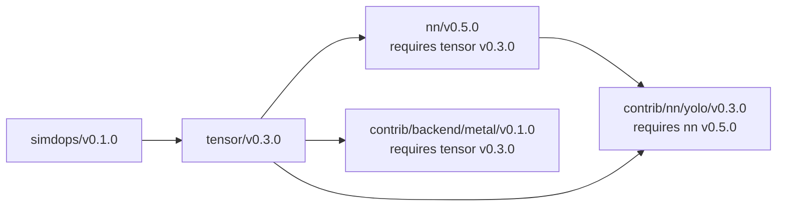
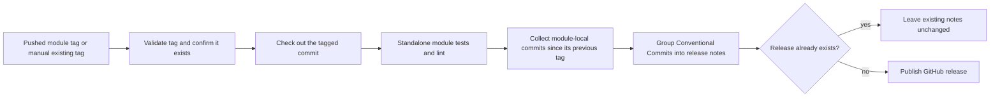

# Releasing

[Documentation](README.md) · [Development](development.md)

Each module has an independent version and a Go subdirectory tag.
This procedure publishes dependencies before their consumers.

**Release set:** tensor/v0.3.0, nn/v0.5.0, contrib/nn/yolo/v0.3.0, and contrib/backend/metal/v0.1.0.
simdops remains at v0.1.0. Publish dependencies in that order so each consumer
can resolve its required numerical APIs and generate verified checksums.
Keep existing published tags unchanged.

## Version and dependency order



| Module | Tag | Required upstream release |
| --- | --- | --- |
| simdops | `simdops/v0.1.0` | None. |
| tensor | `tensor/v0.3.0` | `simdops/v0.1.0` |
| nn | `nn/v0.5.0` | `tensor/v0.3.0` |
| contrib/nn/yolo | `contrib/nn/yolo/v0.3.0` | `nn/v0.5.0` and `tensor/v0.3.0` |
| contrib/backend/metal | `contrib/backend/metal/v0.1.0` | `tensor/v0.3.0` |

Activation, checkpoint, layer, loss, and optimizer packages share the nn module's version.
Do not create separate tags for those subpackages.
The nested Metal examples module is a development workspace module with no release tag.
CUDA and ROCm are unimplemented reservations. Do not publish their tags.

## Prepare the candidate

Run from the repository root:

```sh
mise install --locked
mise run fmt
mise run ci
mise run test:simd
mise run test:fuzz
mise run build:portable
mise run bench:record
```

Review these contracts before tagging:

| Area | Review |
| --- | --- |
| Public API | Names, target types, shape constraints, errors, and compatibility. |
| Memory | Construction copies, view sharing, parameter replacement, and gradient ownership. |
| Numerical behavior | Empty inputs, NaN, infinity, overflow, and comparison tolerances. |
| Dependencies | Actual versioned requirements and no relative replace directives. |
| Examples | Compilable programs, convergence checks, and explicit MNIST data setup. |
| Evidence | Native target tests, reproducible benchmarks, and accurate documentation. |
| Release files | Changelog, module READMEs, license, manifests, and generated checksums. |

Update the validation status for the candidate.
Cross-compilation is not native target execution.
MNIST fixtures do not establish real-dataset accuracy.

## Prepare versioned dependencies

nn requires tensor v0.3.0 for the optimized convolution, joining, and update
kernels. YOLO requires nn v0.5.0 and tensor v0.3.0. Workspace tests use local
source, so validate the versioned dependencies independently before tagging.

## Publish tensor v0.3.0

Validate tensor against simdops v0.1.0 before publishing the reviewed commit:

```sh
GOWORK=off mise run deps:tidy:tensor
GOWORK=off mise run test:tensor
GOWORK=off mise run lint:tensor
git tag tensor/v0.3.0
git push origin main tensor/v0.3.0
```

Do not create a new simdops tag for this release set.

## Verify nn dependencies

Once tensor/v0.3.0 resolves, generate nn's dependency checksums.
Validate the module without local workspace resolution:

```sh
GOWORK=off mise run deps:tidy:nn
GOWORK=off mise run test:nn
```

Review any manifest or checksum changes and commit them when needed.
If no dependency files changed, proceed without an empty dependency commit.

## Publish nn v0.5.0

After the reviewed release commit is on main, create and push the module tag:

```sh
git tag nn/v0.5.0
git push origin main nn/v0.5.0
```

The tag push triggers the release-note workflow.
The workflow verifies the tagged module before creating its GitHub release.
For future upstream changes, publish those modules first and then update their downstream requirements.

## Publish the independent YOLO module

After nn/v0.5.0 and tensor/v0.3.0 resolve publicly, generate the downstream checksums and verify the module:

```sh
GOWORK=off mise run deps:tidy:yolo
mise run test:standalone:yolo
GOWORK=off mise run lint:yolo
git diff -- contrib/nn/yolo/go.mod contrib/nn/yolo/go.sum
```

Commit the generated dependency files, then push the reviewed commit and nested module tag:

```sh
git add contrib/nn/yolo/go.mod contrib/nn/yolo/go.sum
git commit -m "chore(yolo): record published nn dependency checksums"
git tag contrib/nn/yolo/v0.3.0
git push origin main contrib/nn/yolo/v0.3.0
```

Do not invent nn checksums before publication or commit a relative replace directive.
The core standalone gate and test:standalone:yolo validate their own versioned dependencies.
The nested tag triggers module-specific release-note automation with its full installation path.

## Final verification

After all upstream dependencies resolve, run:

```sh
mise run deps:sync
mise run deps:verify
mise run test:standalone
mise run test:standalone:yolo
mise run ci
```

Use a clean consumer environment when checking the published tags.
Record the release commits, tags, verification environment, and performance samples.

## Dependency hygiene

Do not commit relative replace directives to released modules.
The local workspace supplies cross-module development resolution.

Commit go.sum and go.work.sum when Go generates them.
Do not create empty placeholders.
Commit mise dependency-lock sidecars when generated.

For later releases, update downstream requirements to actual published versions.
Review breaking changes deliberately, including changes during v0.x.

## Validate and publish Metal v0.1.0

Complete the tensor release before standalone Metal validation.
Publish nn and YOLO first when verifying the complete integration examples.
Do not query unpublished downstream versions in advance, because a failed proxy lookup can be cached.

On a Mac with supported GPU hardware:

```sh
mise run fmt:check:metal
mise run lint:gpu:metal
mise run lint:gpu:examples
mise run test:gpu:metal
mise run test:gpu:parity
mise run test:gpu:race
mise run test:gpu:portable
GOWORK=off mise run deps:tidy:metal
GOWORK=off mise run test:gpu:metal
GOWORK=off mise run lint:gpu:metal
```

Commit generated Metal checksums before tagging. The Metal runtime must require only tensor and indirect simdops.
Its separate examples module contains nn and YOLO requirements.
Review the [numerical and performance evidence](performance/metal.md) and ownership migration before publication.

```sh
git tag contrib/backend/metal/v0.1.0
git push origin main contrib/backend/metal/v0.1.0
```

The Metal release workflow uses a self-hosted runner labeled self-hosted, macOS, ARM64, and metal.
Configure that runner before pushing the tag. A Linux stub build does not establish GPU support.
The separate manual Metal workflow runs workspace parity and lifecycle checks.
Neither workflow builds or releases CUDA or ROCm.

## If publication fails

| Failure | Action |
| --- | --- |
| Downstream tidy cannot find an upstream version | Check the upstream tag name and public availability. |
| Standalone tests report missing checksums | Tidy that module after the upstream release resolves. |
| Workspace checks pass but standalone checks fail | Inspect versioned manifests without relying on go.work. |
| A published version is incorrect | Prepare a new version. Do not move an existing published tag. |

Publishing tags is an explicit maintainer operation.
This guide describes that operation without authorizing an automated push.

## Automated GitHub release notes

The [release workflow](../.github/workflows/release.yml) runs when a maintainer pushes a matching module tag.
It also accepts an existing tag through workflow_dispatch.
It does not choose versions, change manifests, create tags, or push repository changes.



The notes include an exact installation command, categorized commits, commit links, and a comparison link.
The previous tag comes from the same module's reachable history.
Shared root-only changes do not appear in the module's commit list.
The workflow marks prerelease versions accordingly and does not designate a repository-wide latest release.

Only the publication job receives contents: write permission.
The validation job runs the existing mise tasks with GOWORK=off.
It uses normal Go checksum verification without a persistent exception.
The workflow never modifies an existing release's manually edited notes.

### Publish notes for an existing tag

First push the workflow commit to main.
In GitHub, open Actions, then Release notes, then Run workflow.
Select main and enter one existing module tag, such as `nn/v0.5.0`.
Run it separately for each module that needs release notes.

The workflow supports manual backfills even when an older tag does not contain the workflow file.
No tag deletion or recreation is needed.
Future module tags trigger the workflow automatically when their commits include it.

A GitHub release is a presentation of an existing Go module tag.
Go module resolution depends on the tag, not on this workflow's release-note publication.
The public Go proxy can still cache an earlier failed lookup temporarily.

GitHub documents [tag triggers](https://docs.github.com/en/actions/reference/workflows-and-actions/events-that-trigger-workflows#push)
and the [release API](https://docs.github.com/en/rest/releases/releases#create-a-release).
