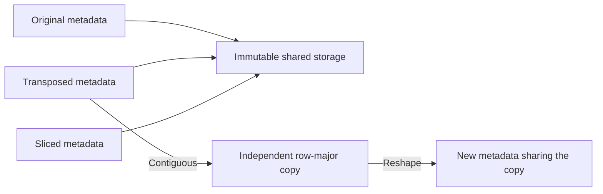

# Tensor semantics

[Documentation](README.md) · [Tensor guide](../tensor/README.md)

This document defines observable tensor behavior.
The [function comments](../tensor/tensor.go) provide the operation-level API reference.

## Construction and shape invariants

Use a constructor.
The zero Tensor value is uninitialized, and public operations reject uninitialized or nil tensor inputs.

| Property | Contract |
| --- | --- |
| Element type | Float32. |
| Contiguous layout | Row-major. |
| Scalar | Rank zero, shape `[]`, one element. |
| Zero dimension | Valid and produces zero elements. |
| Negative dimension | Error. |
| Element count or row-major stride overflow | Error. |
| From input length | Must equal the shape's element count. |
| Shape and Strides accessors | Return independent copies. |

From copies both the caller's values and shape.
Scalar allocates one value.
Zeros and Ones allocate new storage.

Rand samples uniformly from `[0,1)`.
Randn samples a standard normal distribution.
Both require a caller-supplied `*math/rand/v2.Rand`.
A nil generator returns an error.
The caller controls seeding and synchronization.

Layouts must have representable strides even when their total element count is zero.
Shape validation does not guarantee that enough memory exists for an allocation.

## Logical order and reading

At takes exactly one index per dimension.
Each index must lie in `[0,dimension)`.
Negative indices and rank mismatches return errors.
Scalar At takes no indices.

Data copies logical values into row-major order.
It follows shape, strides, and offset rather than returning the backing slice.
String previews at most eight dimensions and eight values.

For values 1 through 6 arranged as `[2,3]`:

| Tensor | Shape | Strides | Data |
| --- | --- | --- | --- |
| Original | `[2,3]` | `[3,1]` | `[1,2,3,4,5,6]` |
| Transpose | `[3,2]` | `[1,3]` | `[1,4,2,5,3,6]` |
| Original sliced on axis 1, range `[1,3)` | `[2,2]` | `[3,1]` | `[2,3,5,6]` |

## Views and materialization

Transpose permutes shape and strides.
With no axes, it reverses dimension order.
Explicit axes must form a complete permutation without duplicates.

Slice selects a half-open `[start,end)` interval on one axis.
The step is always one.
Valid bounds satisfy `0 <= start <= end <= dimension`.
An empty interval is valid.

Reshape requires a contiguous layout and the same element count.
It does not infer a `-1` dimension.
It returns an error rather than copying an unsupported noncontiguous layout.

Contiguous always creates independent row-major storage.
It copies even when the input is already contiguous.



Singleton strides do not affect contiguity.
Empty tensors are contiguous.
View metadata can allocate memory even when element storage is shared.

No public method exposes unrestricted writable tensor storage.
Sharing a view therefore does not permit a caller to mutate its source.

## Broadcasting

Binary arithmetic aligns trailing dimensions.
An aligned pair is compatible when the dimensions are equal or one dimension is 1.
Missing leading dimensions behave as 1.

| Left | Right | Result |
| --- | --- | --- |
| `[32,128]` | `[128]` | `[32,128]` |
| `[10,1,64]` | `[1,64]` | `[10,1,64]` |
| `[4,8]` | `[]` | `[4,8]` |
| `[0,3]` | `[1,3]` | `[0,3]` |
| `[0]` | `[2]` | Error. |

Broadcast arithmetic allocates its output.
There is no public writable broadcast view.

## Reductions

Sum, Mean, and Max remove the selected dimensions.
With no axes, they reduce all dimensions.
Explicit axes must be nonnegative, within rank, and nonduplicated.

| Operation on shape `[0,3]` | Result |
| --- | --- |
| Sum over axis 0 | Shape `[3]`, containing three zeros. |
| Mean or Max over axis 0 | Error because the reduction groups are empty. |
| Sum, Mean, or Max over axis 1 | Shape `[0]`, containing no output elements. |
| Sum over all axes | Scalar zero. |
| Mean or Max over all axes | Empty-reduction error. |

An empty output is valid when the selected dimensions are nonempty.
Large empty shapes must not overflow an intermediate reduction-group calculation.
The implementation derives group sizes from validated element counts.

There is no public keep-dimensions option.
Autograd restores reduced dimensions internally when it broadcasts gradients.

## Mathematical functions and special values

Add, Sub, Mul, Div, Scale, and Neg allocate new arrays.
Exp, Log, and Sqrt preserve shape and allocate new arrays.

| Case | Behavior |
| --- | --- |
| Division by zero | IEEE 754 infinity or NaN. |
| Log of zero | Negative infinity. |
| Log of a negative value | NaN. |
| Sqrt of a negative value | NaN. |
| Exp overflow | Positive infinity. |
| NaN in Max | NaN propagates. |
| Maximum of positive and negative zero | Positive zero. |

Numerical values are stored as float32.
Reductions and matrix products accumulate in float32.
Finite inputs can still overflow, underflow, or lose precision.

Exp, Log, and Sqrt evaluate standard-library float64 functions before rounding to float32.
The API does not guarantee bit-identical reductions across future kernel implementations.

## Matrix multiplication

MatMul accepts rank-two inputs `[m,k]` and `[k,n]`.
It allocates a contiguous `[m,n]` result.
Contiguous inputs, transposed views, and sliced views are supported.

Zero dimensions are valid.
A zero inner dimension produces a zero-filled result.
There is no implicit rank promotion, broadcasting, or batching.

The current loop accumulates in increasing inner-dimension order.
It does not pack operands or launch parallel workers.

## Errors and concurrency

Errors identify the failed operation and relevant shapes or bounds.
For example:

```text
tensor: matmul: incompatible shapes [2 3] and [4 5]
```

Invalid user inputs return errors from fallible operations.
Methods with constructor preconditions, such as metadata accessors, require an initialized receiver.

Immutable tensor reads can run concurrently.
Caller-owned random generators and nn parameter updates have separate synchronization requirements.
See [autograd](autograd.md) for model and gradient ownership.

## Explicit GPU storage

CPU storage and numerical contracts remain unchanged. GPU tensors keep the same shape,
strides, offset, and Float32 layout through opaque, reference-counted storage leases.
Operations preserve their input device. Mixed devices and unsupported kernels return errors.
Views retain independent leases and share immutable values.

GPU Data and Contiguous panic. HostData, ToCPU, and MakeContiguous provide explicit fallible alternatives.
At returns an error for GPU storage. String shows metadata without downloading values.
Close retained GPU tensors and iteration scopes explicitly. Device shutdown synchronizes pending work.
See [GPU contracts and migration](gpu.md) for complete ownership and synchronization rules.
