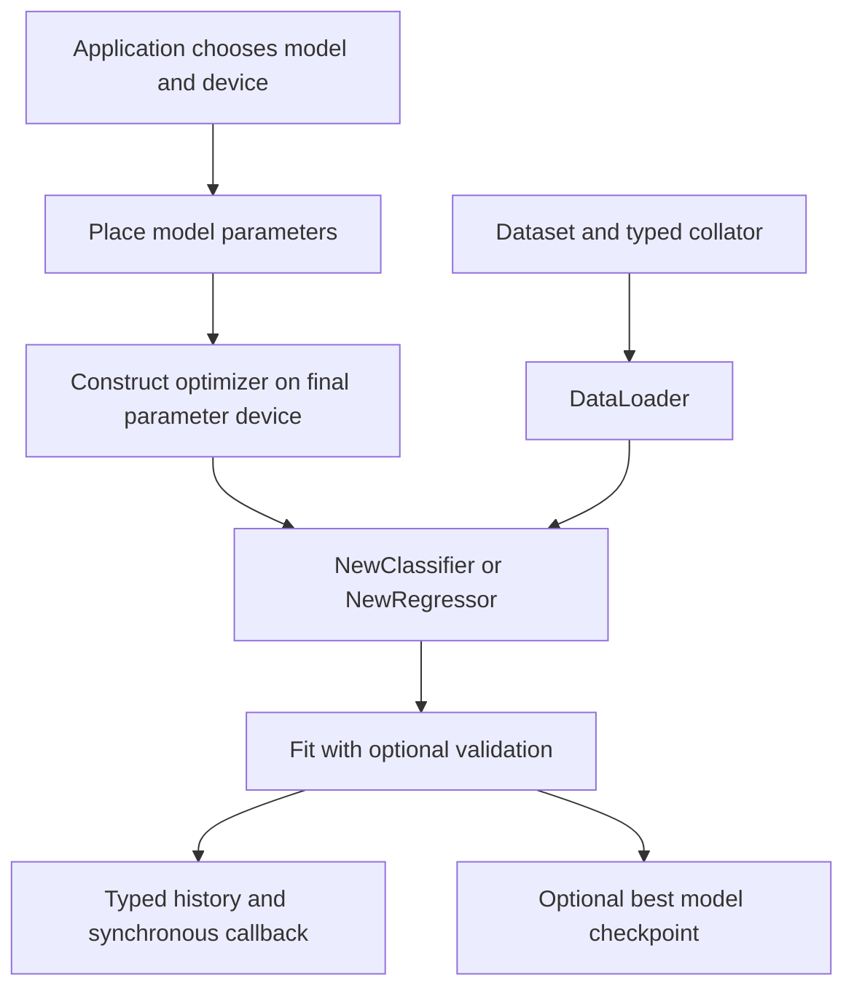

# Training with goml

[Trainer](../trainer/README.md) · [Datasets](datasets.md) · [Metrics](metrics.md)

Trainer orchestrates the existing nn operations. Low-level custom training loops
remain supported. Model architecture, dataset selection, device creation, and
optimizer hyperparameters belong to the application.

## Select and place the model

Default CPU execution needs no CGo. Use tensor.CPU(), place the parameters with
nn.ToDevice, and construct the optimizer afterward. Applications can instead open
an optional Metal or WebGPU device and pass it through the same backend.Device
contract. Trainer imports neither implementation. No parameter migration or CPU
fallback is implicit.

The [MNIST application](../nn/examples/mnist/README.md) has separate `metal` and
`webgpu` build tags. Ordinary builds do not link their native libraries.



## Choose the task

| Entry point | Batch type | Loss | Validation |
| --- | --- | --- | --- |
| NewClassifier | *data.ClassificationBatch | Stable mean cross-entropy on logits. | Accuracy, confusion, per-class and averaged precision/recall/F1. |
| NewRegressor | *data.RegressionBatch | Mean squared error, exact prediction/target shape. | MAE, MSE, RMSE, and explicitly valid/undefined R². |
| Fit[B] | Application-defined B | Application-owned StepFunc. | Application-owned evaluation step and optional typed accumulators. |

Existing layer.Sequential satisfies Model: Forward, Predict, Parameters.
Existing nn optimizers satisfy the consumer contract. BatchSource[B] accepts any
data.Loader[S,B]; Trainer does not need to know S. Empty training/evaluation
sources return errors. Model, optimizer, device, and metrics are borrowed.

## Train and report

FitOptions.Epochs is positive. EpochReport.Epoch starts at one; loaders receive
zero-based epochs for deterministic shuffling. Train.MeanLoss and validation loss
are weighted by sample count, so the final partial batch has its actual weight.
Multi-output regression metrics weight each scalar output equally.

Without validation, pass nil and check that Validation is nil before accessing
its report. With validation, task-specific snapshots belong to that epoch and
remain valid after subsequent evaluations. Callback reports are independently
copied. No tensors, full-dataset predictions, or logs accumulate in history.

OnEpochEnd runs synchronously after successful evaluation and best-checkpoint
saving. Errors stop Fit and preserve completed epoch reports. Earlier optimizer
updates are not rolled back. Context cancellation stops further loading/steps;
a batch already yielded still receives cleanup.

## Plug in custom metrics

Metrics defines generic Accumulator[P,T] for Update and Reset, and
Metric[P,T,R] additionally exposes a typed Result. Trainer consumes only the
update/reset boundary; users retain their concrete result type.

```go
custom := meanbias.New()
runner, err := trainer.NewRegressor(model, opt, device, custom)
if err != nil {
	return err
}

history, err := runner.Fit(ctx, train, validation, trainer.FitOptions{
	Epochs: 10,
	OnEpochEnd: func(report trainer.EpochReport) error {
		result, err := custom.Result()
		if err != nil {
			return err
		}

		fmt.Println(report.Epoch, result.MeanBias)
		return nil
	},
})
```

The runnable [regression example](../trainer/examples/regression/main.go) imports
that metric from [metrics/examples/custom](../metrics/examples/custom/README.md).
An external package implements the same methods with no registration or Trainer
import. Classification plugins take raw flattened logits and integer targets;
regression plugins take flattened Float32 slices. A built-in Classification's
Logits() adapter or a Regression instance can be passed directly.

Trainer resets plugins at each evaluation, updates every batch, and propagates
errors. They share a single prediction download. Inputs are borrowed and cannot
be retained or mutated. Save custom result snapshots in the callback when you
need per-epoch history. Failed evaluation can leave prefix statistics; the next
one resets them. Training-only runs leave plugins untouched.

## Evaluate independently

Use runner.Evaluate, or EvaluateClassification/EvaluateRegression without an
optimizer. Predict avoids graph creation. Evaluation neither calls Step nor
clears existing model gradients. It reads final predictions explicitly for
streaming host metrics, then releases temporary tensors. A missing capability or
native execution failure propagates; it never selects a CPU substitute.

## Stop and save

EarlyStopping requires validation, positive Patience, and finite nonnegative
MinDelta. The first validation establishes a baseline. A loss decrease strictly
greater than MinDelta resets the consecutive-miss count. Patience misses stop
before the next epoch without an error. History.StoppedEarly and StopReason
explain this outcome.

BestCheckpointPath also requires validation. Every strictly lower validation loss
is saved independently of MinDelta. The existing checkpoint implementation writes
atomically. Sequential models use supported architecture codecs and weights;
other Model implementations save only their ordered parameters. Save errors
propagate. Checkpoint filenames should differ from final-save outputs.

The caller explicitly loads the best checkpoint afterward. Optimizer moments,
step counters, data-order position, and callbacks are not serialized. This is
model selection, not complete training-state resumption.

## Resource ownership

Each built-in step closes the yielded CPU batch and a per-batch Tensor scope on
success or failure. Parameters and optimizer state remain resident on their
selected device. Gradients clear before and after each training step, including
failure paths. Trainer never closes application-owned model/optimizer/device.
Custom model outputs must be owned handles, and custom Tensor operations should
propagate scopes. Use Retain when returning an existing parameter allocation.

GPU work uses backend queue ordering and retention. Host scalar-loss reads and
validation downloads synchronize as required by Tensor; there is no additional
synchronization after each operation. Metric accumulators and runners are not
safe for concurrent mutation without application synchronization.

Generic Fit[B] gives a typed StepFunc full control over its numerical task. That
step owns batch cleanup and gradients even on cancellation. The
[reconstruction example](../trainer/examples/custom/README.md) shows a custom loss
and Tensor batch without a universal Task interface.

## Verify the implementation

```sh
mise run test:trainer
mise run test:trainer:race
mise run test:standalone:trainer
mise run example:trainer
mise run test:trainer:metal
mise run test:trainer:webgpu
```

The last two commands require actual supported hardware. See
[measurements](performance/trainer.md) for the executed workloads and limits.
