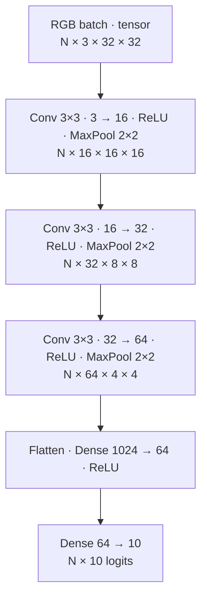
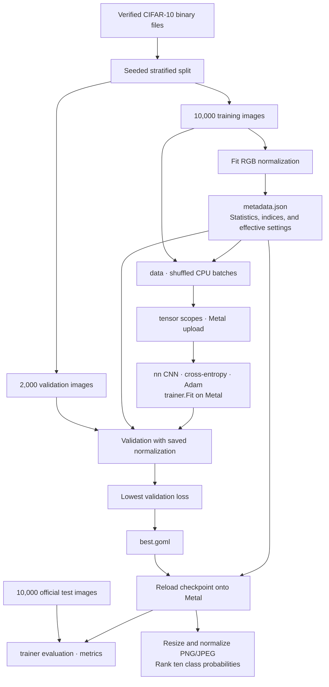

# CIFAR-10 training on Metal

Train a real image classifier from scratch with goml, then reload its best
checkpoint for held-out evaluation and image prediction. This is an application
module in the repository workspace, not a separately published library.

The application uses **tensor** for tensors and device scopes, **nn** for the CNN,
autograd, Adam, and checkpoints, **metrics** for classification reports,
**trainer** for training and validation, and **metal** for GPU execution. The data
package supplies datasets, deterministic shuffling, and owned batches.

## Run

Use the repository checkout with Go 1.27.3, macOS, Xcode command-line tools, CGo,
and a supported Metal GPU. No extra Go build tag is needed for the application.
An unsupported platform or failed Metal initialization returns an error.

From `example/`:

```sh
go run . download
go run . train
go run . evaluate
go run . predict -image /path/to/photo.jpg
```

Or from the repository root:

```sh
mise run example:cifar10 -- download
mise run example:cifar10 -- train
mise run example:cifar10 -- evaluate -split validation
mise run example:cifar10 -- predict -image /path/to/photo.jpg
```

The download command explicitly fetches the approximately 162 MB official binary
archive and checks its published MD5 checksum before extracting the expected
batch files. Training never downloads data. Dataset files, checkpoints, and
metrics stay in the Git-ignored `archive/` directory inside this module.

For a slow official server, `download -url URL` accepts a binary archive mirror;
it still requires the official checksum. For example, the
[BrainChip mirror](https://data.brainchip.com/dataset-mirror/cifar10/):

```sh
go run . download -url https://data.brainchip.com/dataset-mirror/cifar10/cifar-10-binary.tar.gz
```

Downloads have no overall transfer deadline; Ctrl-C cancels them and removes
temporary files. A canceled download restarts from the beginning.

Every command accepts `-data` (default `archive/cifar-10-batches-bin`) and `-run`
(default `archive/run`). Training requires a new run directory to preserve
previous checkpoints and preprocessing metadata:

```sh
go run . train -run archive/second-run -epochs 30 -batch 32 -seed 42
go run . evaluate -run archive/second-run
```

`train` also accepts `-train-per-class` (1000) and `-validation-per-class` (200).
`-patience` defaults to five; zero disables early stopping. To complete exactly
50 epochs while retaining both the best validation model and final weights:

```sh
go run . train -epochs 50 -patience 0 -run archive/run-50
```

Smaller counts are useful for checking the real-data pipeline; they change the
experiment and should be reported with its accuracy. `evaluate -split test`
uses the official test set; `-split validation` reuses the saved validation
indices. Prediction accepts PNG/JPEG, resizes to 32×32 with bilinear sampling,
and prints all ten classes ranked by softmax probability. Arbitrary photographs
can differ substantially from CIFAR-10's small object images.

## Dataset and model

The [official CIFAR-10 dataset](https://www.cs.toronto.edu/~kriz/cifar.html)
contains 50,000 training and 10,000 test RGB images, each 32×32, in ten classes.
The default experiment selects 1000 training and 200 validation images per class
from the official training files: **10,000 training / 2,000 validation**. The
remaining 38,000 training images are unused. Splits are disjoint, stratified,
seeded, and saved as indices into the five concatenated training batches.

Images stay as compact bytes until batching. Per-channel means and population
standard deviations are calculated using only the selected training pixels.
Validation, testing, and prediction reuse these saved statistics. There is no
random augmentation. The official test split is opened after training and best
checkpoint selection have finished.



All convolutions have stride one, padding one, and bias. Pooling has kernel and
stride two. The model has **89,834 trainable parameters**, using goml's existing
Xavier initialization. The same seed controls initialization and data selection;
the loader combines it with the epoch to shuffle training samples.

Training uses mean cross-entropy and Adam with learning rate 0.001, beta1 0.9,
beta2 0.999, epsilon 1e-8, batch size 32, and at most 30 epochs. Early stopping
uses patience five and minimum loss improvement 0.001. The best checkpoint tracks
the strictly lowest validation loss independently of the stopping threshold.
Training metrics include partial final batches and are weighted by sample count.

Parameters and Adam moments remain on Metal. Trainer explicitly transfers each
complete CPU batch and closes temporary scopes before the next batch. Only
reporting values, evaluation scores, and checkpoint weights are read back to
the host. Interrupting the command cancels the run; completed-epoch metrics and
the best checkpoint remain available. Saved checkpoints contain architecture
and weights, not optimizer state; this application does not offer exact resume.



## Run artifacts

| File | Contents |
| --- | --- |
| `metadata.json` | Model identifier, dataset source/checksum, device, configuration, classes, training-only normalization, and split indices. |
| `epochs.jsonl` | One flushed report per completed epoch: train loss, validation loss/accuracy, and elapsed seconds. |
| `history.json` | Completed epochs, stopping reason, and total Fit duration, including partial history on cancellation. |
| `best.goml` | Model architecture and weights at the lowest validation loss. |
| `final.goml` | Model architecture and weights after the last completed epoch of a successful run. |
| `test.json` | Reloaded best-model test loss, accuracy, precision/recall/F1, confusion counts, and evaluation time. |
| `validation.json` | Same report for an explicitly requested validation evaluation. |

Training automatically reloads `best.goml` and evaluates all 10,000 official test
images once. Running `evaluate` repeats this optimizer-free evaluation. Confusion
matrix rows are actual classes and columns are predicted classes, using the
class order in `metadata.json`. Prediction probabilities are model scores, not
calibrated confidence guarantees.

## Verify

From the repository root:

```sh
mise run fmt:example
mise run lint:example
mise run test:example
mise run test:example:metal
mise run build:example
```

Formatting uses gofumpt/goimports plus **wsl_v5**. Ordinary tests use local
fixtures and a local HTTP server; they do not download CIFAR-10 or open Metal.
The explicit Metal task enables native integration tests with the race detector:
CPU/GPU score agreement, finite device gradients, actual Adam updates, two epochs
with partial batches, validation/checkpointing, and native buffer cleanup.

The untagged trainer module is resolved from the repository's `go.work`, following
the existing MNIST application convention. Keep workspace mode enabled; this
example is not currently a standalone `GOWORK=off` installation.

## Measured runs

Measured on 2026-11-18 with Go 1.27.3 and Apple M1 Pro using Metal. The first
run used the defaults: 10,000 training images, 2,000 validation images, batch 32,
seed 42, Adam 0.001, and a 30-epoch maximum with early stopping.

| Measurement | Default run |
| --- | ---: |
| Completed epochs | 9; early stopping |
| Selected checkpoint epoch | 4; lowest validation loss |
| Training and validation time | 127.15 seconds |
| Selected checkpoint validation accuracy | 60.50% |
| Selected checkpoint validation cross-entropy | 1.14425 |
| Official test images | 10,000 |
| Test accuracy | **58.55%** |
| Test cross-entropy | 1.17556 |
| Test macro F1 | 0.58202 |
| Test evaluation time | 1.95 seconds |

The selected checkpoint was reloaded for evaluation; its validation metrics
were reproduced by the separate `evaluate -split validation` command. Training
time excludes dataset download and parsing, model setup, and final test evaluation.
This is one seeded run, not a multi-seed accuracy estimate or a CPU/GPU speed
comparison. Training loss fell from 1.7688 to 0.5278; validation loss was lowest
at epoch four, showing overfitting despite continuing training loss improvement.

The dataset for this run came from the BrainChip binary mirror and matched the
official archive checksum `c32a1d4ab5d03f1284b67883e8d87530`.

Dataset reference: Alex Krizhevsky, *Learning Multiple Layers of Features from
Tiny Images*, 2009, [technical report](https://www.cs.toronto.edu/~kriz/learning-features-2009-TR.pdf).
