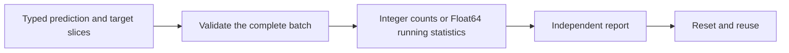

<div align="center">


# metrics

**Streaming classification and regression evaluation, using the Go standard library.**


[Quick start](#quick-start) · [Classification](#classification) · [Regression](#regression) · [Validation](#validation) · [Project](../README.md)

</div>

---

metrics evaluates predictions without retaining individual observations. It has
no Tensor, data, neural-network, or hardware dependencies. Updates validate the
whole batch before changing state. Results are independent snapshots; Reset clears
observations for reuse. Accumulators need no Close method.

The module is `github.com/bpradana/goml/metrics`; its release tag is
`metrics/v0.1.0`:

```sh
go get github.com/bpradana/goml/metrics@v0.1.0
```

## Quick start

```go
metric, err := metrics.NewClassification(3)
if err != nil {
	return err
}

if err := metric.Update([]int{1, 2, 0}, []int{1, 0, 0}); err != nil {
	return err
}

result, err := metric.Result()
if err != nil {
	return err
}

fmt.Println(result.Accuracy, result.Confusion)
```

The [classification](examples/classification/README.md) and
[regression](examples/regression/README.md) programs demonstrate streaming multiple
batches. No datasets, devices, frameworks, or network services are required.

## Classification

NewClassification takes the positive class count and allocates an O(classes²)
confusion matrix. Update accepts predicted/actual integer class IDs. UpdateLogits
accepts flattened `[batch,classes]` Float32 scores and integer targets. Scores
must be finite; ties select the lowest class index. Softmax is unnecessary.

Confusion rows are actual classes and columns predicted classes:
`result.Confusion[actual][predicted]`. Reports contain Count, Accuracy, micro,
macro, and support-weighted precision/recall/F1, plus per-class statistics.

| Convention | Behavior |
| --- | --- |
| Undefined class precision, recall, or F1 | Zero. |
| Macro averaging | Includes every configured class, including unsupported classes. |
| Weighted averaging | Uses actual class support. |
| Micro averaging | Equals accuracy for single-label multiclass observations. |
| Empty Result | Explicit error. |
| Invalid Update | Error; all previous counters remain unchanged. |

Counters are uint64; overflow is rejected. Ratios use Float64, so very large
counts can round when converted beyond its exact-integer range. The byte count
is checked before confusion allocation, but callers must choose class counts
appropriate for their available memory.

## Regression

NewRegression (or a zero-valued Regression) accepts finite, equally sized
prediction/target Float32 slices. It accumulates absolute/squared errors using
compensated Float64 sums and target variance using Welford's online algorithm.
It does not subtract two large global sums to calculate R².

Result contains Count, MAE, MSE, RMSE, R2, and R2Valid. R² is NaN with R2Valid=false
for fewer than two observations or constant targets. Other error metrics remain
valid in those cases. Empty results return errors. Negative R² values are valid
when predictions are worse than predicting the target mean.

Multi-output values are flattened: every scalar output has equal weight. Per-output
reporting and sample-level weighting are not inferred. An invalid update changes
none of the numerical state, including variance statistics.

## Custom metrics and Trainer

`Metric[P,T,R]` defines typed Update, Result, and Reset methods. P/T are slice
element types and R is your own report type. `Accumulator[P,T]` is the smaller
update/reset contract consumed by Trainer. Built-ins satisfy these interfaces;
third-party packages can implement them directly without registration.

Use `classification.Logits()` to adapt a Classification accumulator to raw-score
updates for Trainer. Regressions can be passed directly. Custom classification
metrics receive raw logits, preserving score information for Top-K or confidence
metrics, and all configured metrics reuse the same downloaded predictions.
Results remain available through each concrete metric's typed Result method.
See the [custom metric example](examples/custom/README.md) and\n[extension guide](../docs/metrics.md).

## Ownership and lifecycle

Update borrows slices only during the call. Result copies mutable report arrays;
modifying a returned confusion matrix or resetting the accumulator cannot change
another snapshot. Repeated Result calls do not mutate state. Reset preserves the
classification allocation and performs no new allocation.

Callers synchronize concurrent mutation. No mutexes, background workers, global
registry, Tensor handles, files, or native buffers are owned by metrics.



## Validation

```sh
mise run test:metrics
mise run test:standalone:metrics
mise run lint:metrics
mise run bench:metrics
```

Tests use independently derived numerical references, missing/imbalanced classes,
streaming partitions, snapshot/reset behavior, invalid-update atomicity, ties,
nonfinite scores, large offsets, very small errors, and undefined R² cases.
Both update benchmark families allocate zero Go objects in the recorded run.
See [measurements](../docs/performance/metrics.md) for sizes and limitations.

[Metric conventions](../docs/metrics.md) · [Releases](../docs/releasing.md)

Licensed under [MIT](../LICENSE).
