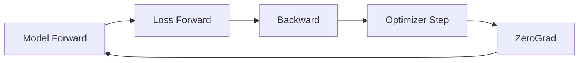

<div align="center">


# nn

**Eager differentiation, dense networks, typed losses, and optimizers built on tensor.**

[Training example](#training-example) · [Packages](#packages) · [Graph lifecycle](#graph-lifecycle) · [Inference](#inference) · [Project](../README.md)

</div>

---

nn records differentiable operations during the forward pass.
Backward traverses the graph in reverse order and accumulates gradients.
The underlying [tensor](../tensor/README.md) module remains an ordinary numerical library.

The module path is `github.com/bpradana/goml/nn`.
Activation, layer, loss, and optimizer packages belong to this module.
Use the local workspace until the upstream module tags are published.

## Packages

| Import suffix | Main API | Responsibility |
| --- | --- | --- |
| `/nn` | `Value`, `Parameter`, numerical operations | Immutable values, differentiable primitives, and graph ownership. |
| `/nn/layer` | `Layer`, `NewDense`, `NewSequential` | Model composition and parameter discovery. |
| `/nn/activation` | `NewReLU`, `NewSigmoid`, `NewTanh` | Element-wise activation layers and their derivative rules. |
| `/nn/loss` | `Loss[T]`, `NewMSE`, `NewCrossEntropy` | Scalar objectives with explicit target types. |
| `/nn/optimizer` | `Optimizer`, `NewSGD`, `NewAdam` | Parameter updates, gradient clearing, and Adam moments. |

Each import starts with `github.com/bpradana/goml`.
The subpackages depend on nn. nn does not import its subpackages.

## Training example

Run the complete seeded examples from the repository root:

```sh
mise run example:linear
mise run example:xor
```

The linear example learns `y = 2x + 1` with SGD.
It requires predictions within 0.001 of the targets.
The XOR example composes two Dense layers with Tanh and Sigmoid activations and uses Adam.
It requires predictions within 0.1 after 1,000 steps.

<details>
<summary><b>Complete linear regression program</b></summary>

This program is the compiled, tested [linear example](examples/linear/main.go):

```go
package main

import (
	"fmt"
	"log"
	"math"
	"math/rand/v2"

	"github.com/bpradana/goml/nn"
	"github.com/bpradana/goml/nn/layer"
	"github.com/bpradana/goml/nn/loss"
	"github.com/bpradana/goml/nn/optimizer"
	"github.com/bpradana/goml/tensor"
)

func main() {
	if err := run(); err != nil {
		log.Fatal(err)
	}
}

func run() error {
	rng := rand.New(rand.NewPCG(1, 2))

	dense, err := layer.NewDense(1, 1, true, rng)
	if err != nil {
		return err
	}

	model, err := layer.NewSequential(dense)
	if err != nil {
		return err
	}

	x, err := tensor.From([]float32{-1, 0, 1, 2}, 4, 1)
	if err != nil {
		return err
	}

	y, err := tensor.From([]float32{-1, 1, 3, 5}, 4, 1)
	if err != nil {
		return err
	}

	input, err := nn.NewValue(x, false)
	if err != nil {
		return err
	}

	target, err := nn.NewValue(y, false)
	if err != nil {
		return err
	}

	opt, err := optimizer.NewSGD(model.Parameters(), 0.05)
	if err != nil {
		return err
	}

	var criterion loss.Loss[*nn.Value] = loss.NewMSE()

	for iteration := 0; iteration < 1000; iteration++ {
		prediction, err := model.Forward(input)
		if err != nil {
			return err
		}

		objective, err := criterion.Forward(prediction, target)
		if err != nil {
			return err
		}

		if err := objective.Backward(); err != nil {
			return err
		}

		if err := opt.Step(); err != nil {
			return err
		}

		opt.ZeroGrad()
	}

	prediction, err := model.Predict(x)
	if err != nil {
		return err
	}

	for i, got := range prediction.Data() {
		if math.Abs(float64(got-y.Data()[i])) > 0.001 {
			return fmt.Errorf("linear: training did not converge at example %d: got %g", i, got)
		}
	}

	fmt.Println(prediction)

	return nil
}
```

</details>

Every iteration constructs a new forward graph:



## Values and parameters

NewValue wraps an immutable tensor without copying its element storage.
The tracking flag identifies a differentiable leaf.

| Value or operation | Gradient behavior |
| --- | --- |
| `nn.NewValue(data, true)` | Tracks gradients for this leaf. |
| `nn.NewValue(data, false)` | Creates a constant leaf. Parameters can still cause later operations to record graphs. |
| `nn.NewParameter(data)` | Creates a trainable leaf with stable identity. |
| `Value.Detach()` | Shares immutable data in a new constant leaf without the old graph. |
| `Value.Grad()` | Returns the accumulated immutable gradient, or nil. |
| `Value.ZeroGrad()` | Clears this value's gradient. |

Parameter.Update requires the same shape.
It replaces tensor data without changing parameter identity or clearing gradients.
Optimizers use this boundary.

NewOperation registers a single-input backward rule for an already-computed result.
It validates gradient shapes while keeping graph fields private.
See [custom operations](../docs/autograd.md#custom-operations) for the callback contract.

## Layers

Dense computes `XW+b` for `X=[batch,in]`, `W=[in,out]`, and optional `b=[out]`.
NewDense takes positive input/output dimensions, a bias flag, and a caller-owned random generator.
Weights use Xavier normal initialization with variance `2/(in+out)`.
Bias starts at zero.

Construct stateless activations with activation.NewReLU, activation.NewSigmoid, and activation.NewTanh.
Their concrete types implement the existing Layer interface and expose no parameters.
Their calculations and derivative rules live in nn/activation, using nn.NewOperation.
A separate activation interface would duplicate the Layer contract.
NewSequential applies layers in order.
Parameters returns each shared parameter once.

The [Layer interface](layer/layer.go) contains only Forward and Parameters.
There is no reflection-based discovery or layer registry.

## Losses

Construct loss objects with NewMSE and NewCrossEntropy. Both expose one Forward method:

| Loss object | Interface | Target contract |
| --- | --- | --- |
| `loss.NewMSE()` | `loss.Loss[*nn.Value]` | A nonempty Value with the same shape as prediction. |
| `loss.NewCrossEntropy()` | `loss.Loss[[]int]` | One integer class index per logit row. |

MSE averages all squared element errors and can differentiate both inputs.
It rejects target broadcasting.

CrossEntropy accepts finite logits shaped `[batch,classes]`.
Both dimensions must be positive.
Labels must lie in `[0,classes)`.
It averages shifted log-sum-exp losses and differentiates logits only.

The generic target parameter keeps target types explicit.
Losses with the same target type can share a training-loop interface.
Loss calculations and derivative rules live entirely in nn/loss.
CrossEntropy registers its backward rule through nn.NewOperation.
The core nn package owns graph recording and validates the returned gradient shape.

## Optimizers

| Constructor | Behavior |
| --- | --- |
| `optimizer.NewSGD(parameters, rate)` | Gradient descent without momentum. |
| `optimizer.NewAdam(parameters, rate, beta1, beta2, epsilon)` | Bias-corrected first and second moments. |

The learning rate must be finite and positive.
Adam's betas must be finite in `[0,1)`, and epsilon must be finite and positive.
Common Adam settings are `0.9`, `0.999`, and `1e-8`.

Constructors copy and deduplicate the parameter list.
Step skips parameters without gradients and retains gradients after updates.
ZeroGrad clears gradients for the optimizer's parameters.
Adam advances a parameter's moment counter only when that parameter has a gradient.

Optimizer state belongs to the optimizer.
It is separate from tensors and models.

## Graph lifecycle

Backward accepts a scalar output and seeds it with one.
BackwardWith accepts an explicit seed with the output's exact shape.

A successful pass accumulates gradients, releases saved graph resources, and consumes operation nodes.
A second backward pass through a consumed graph returns an error.
A shared dependency consumed by another branch also returns an error.

Create a new forward pass for another training iteration.
Use Detach only when the previous result should act as a constant.
See [autograd semantics](../docs/autograd.md) for accumulation, sharing, and failure behavior.

## Inference

A constant input alone does not disable a model's trainable parameters.
Use nn.Inference or Sequential.Predict to suppress graph recording.

Predict accepts a plain tensor and returns a plain tensor.
Inference retains no parent lists or backward closures.
Independent inference calls can read the same model while parameters remain unchanged.

Training, backward, updates, and gradient clearing require external synchronization.

## MNIST

The [MNIST example](examples/mnist/README.md) reads local gzip-compressed IDX files.
Downloads are explicit. Tests generate small local fixtures and exercise the loader and a training step.

The default model is 784 → 32 → 10 with ReLU and Adam.
The example reports training cross-entropy.
No real-dataset or held-out accuracy result is claimed.

## Verification and limits

| Purpose | Command |
| --- | --- |
| nn tests, including examples | `mise run test:nn` |
| nn lint | `mise run lint:nn` |
| Race detection | `mise run test:race` |
| Experimental SIMD through the full stack | `mise run test:simd` |
| Neural network and optimizer benchmarks | `mise run bench:nn` |

Finite-difference checks cover operations, reductions, views, activations, and losses.
Exact tests cover shared graphs, accumulation, consuming backward, typed loss interfaces, and optimizer references.
See [validation](../docs/testing.md) and [performance](../docs/performance.md).

The current release scope covers dense networks and first-order eager differentiation.
There is no retain-graph option, higher-order autodiff, convolution, transformer API, or checkpoint format.

Licensed under [MIT](../LICENSE).
