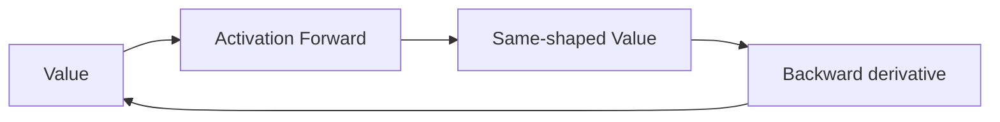

# Activations

[nn](../README.md) · [Layers](../layer/README.md) · [Autograd](../../docs/autograd.md)

Package activation provides stateless element-wise and axis-wise activation layers.
The concrete types implement layer.Layer and compose directly with Sequential.
All constructors return parameterless layers; none requires a separate module or activation interface.

## Choose an activation

| Constructor | Computation | Numerical behavior |
| --- | --- | --- |
| `NewReLU()` | `max(0,x)`. | The derivative at zero is zero. |
| `NewSigmoid()` | Logistic sigmoid. | Stable evaluation avoids exponential overflow for negative inputs. |
| `NewTanh()` | Hyperbolic tangent. | Saturates toward -1 and 1. |
| `NewSiLU()` | `x*sigmoid(x)`. | Stable sigmoid; negative infinity maps to negative zero. Available in nn v0.3.0. |
| `NewSoftmax(axis)` | Normalized exponentials along an axis. | Subtracts each row maximum; the axis must be valid at Forward. |

Forward preserves the input shape and allocates a new result.
Invalid inputs and consumed graphs return errors.
See each function's GoDoc for NaN, infinity, and empty-dimension behavior.

## Compose with trainable layers

Given two Dense layers named hidden and output:

```go
model, err := layer.NewSequential(hidden, activation.NewSiLU(), output)
if err != nil {
    return err
}
```

For classification with [cross-entropy](../loss/README.md), pass raw logits to the loss.
Softmax is useful when probabilities are required by an inference consumer.



## Gradients and inference

Each implementation owns its derivative rule and registers it through nn.NewOperation.
Repeated graph dependencies accumulate gradients through nn's normal backward lifecycle.
Inference inputs propagate inference mode and do not retain gradient graphs.
Activations expose no parameters or mutable state and can be shared across models.
Built-in activations round-trip through [network checkpoints](../checkpoint/README.md).

## Verify

```sh
mise run test:nn
mise run lint:nn
```

Tests cover finite-difference gradients, extreme values, invalid inputs, and inference behavior.

## GPU execution

ReLU, Sigmoid, Tanh, SiLU, and Softmax preserve the tensor device in forward and backward operations.
GPU intermediates remain resident and follow the input's temporary scope.
Float32 rounding can differ from CPU implementations that use wider intermediate arithmetic.
See [GPU scope ownership](../../docs/gpu.md#explicit-lifetimes) and the [Metal parity report](../../docs/performance/metal.md).
