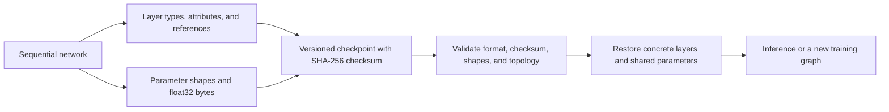

# Checkpoints

[nn](../README.md) · [MNIST save and load](../examples/mnist/README.md#save-load-and-predict)

Package checkpoint saves float32 weights and complete built-in Sequential networks.
It uses Go's standard library and requires no external model runtime.
This package is included in nn v0.2.0.

## Choose what to save

| API | Saved content | Load behavior |
| --- | --- | --- |
| `checkpoint.SaveWeights(path, model.Parameters())` | Ordered parameter shapes and values. | `LoadWeights` updates a matching existing model. |
| `checkpoint.Save(path, model)` | Architecture, parameter shapes, values, and shared references. | `Load` constructs a new Sequential model. |
| `checkpoint.Marshal(model)` | The complete network as checkpoint bytes. | `Unmarshal` constructs a new Sequential model. |

SaveWeights works with any ordered list of distinct parameters, including custom layers.
Complete-network serialization supports every current built-in layer and activation.
Unknown custom layer types return an error.
Network files and weights-only files have different kinds and are not interchangeable.

## Save and restore weights

Given an existing model, check both operations for errors:

```go
if err := checkpoint.SaveWeights("data/weights.goml", model.Parameters()); err != nil {
    return err
}

if err := checkpoint.LoadWeights("data/weights.goml", model.Parameters()); err != nil {
    return err
}
```

The destination parameter count, order, and shapes must match the saved model.
Matching shapes alone do not identify the meaning of differently ordered parameters.
An architecture is not stored in a weights-only file.

LoadWeights validates the complete file before updating any parameter.
On success, it preserves parameter identity, replaces immutable values, and clears gradients.
On failure, parameter values and gradients remain unchanged.
Old tensor views retain their original values.

## Save and restore a network

Save an existing `*layer.Sequential`:

```go
if err := checkpoint.Save("data/network.goml", model); err != nil {
    return err
}
```

Load its architecture and weights without calling the original model constructor:

```go
restored, err := checkpoint.Load("data/network.goml")
if err != nil {
    return err
}

prediction, err := restored.Predict(input)
if err != nil {
    return err
}
```

For storage that already accepts byte slices, use the same format in memory:

```go
encoded, err := checkpoint.Marshal(model)
if err != nil {
    return err
}

restored, err := checkpoint.Unmarshal(encoded)
if err != nil {
    return err
}
```

Restoration uses the saved tensors directly, without random weight initialization.
The new network owns independent parameter storage and has no saved gradients or computation graph.
It can run inference or build a fresh training graph.
Shared layers and parameters remain shared within the restored network.
Nested Sequential models retain their structure.



## Format version 1

| Field | Size | Encoding |
| --- | --- | --- |
| Magic and format version | 8 bytes. | ASCII `GOMLCP01`. |
| Payload length | 8 bytes. | Unsigned little-endian integer. |
| Payload checksum | 32 bytes. | SHA-256 of the exact payload bytes. |
| Payload | Up to 64 MiB. | JSON metadata with base64-encoded float32 arrays. |

Each parameter stores dtype `float32`, shape, and little-endian IEEE 754 bytes.
Rank-zero parameters and zero-sized dimensions are supported.
Values preserve their bit patterns, including signed zero, NaN, and infinity.
Parameter views are saved in logical row-major order and restored as contiguous tensors.

Network metadata contains concrete layer kinds, attributes, child references, and parameter references.
The architecture limit is 10,000 distinct layers and 64 nested layer levels.
The loader rejects invalid references, cycles, unreachable nodes, unused parameters, and inconsistent layer shapes.
It rejects unknown versions, kinds, dtypes, layer types, and JSON fields.
Truncation, trailing bytes, size overflow, and checksum mismatches return errors.

The checksum detects accidental corruption. It does not authenticate the file's producer.
The format does not execute constructors supplied by a file or deserialize arbitrary Go objects.

## File replacement and ownership

Save functions create parent directories when necessary.
They write an owner-only temporary file in the destination directory, sync it, close it, and rename it.
An encoding or write failure leaves an existing destination file unchanged.
Atomic replacement assumes POSIX filesystem behavior.
Two separate save calls are independent file replacements, not a multi-file transaction.

Synchronize persistence with model training and parameter updates.
Saving does not clear or mutate gradients.
LoadWeights clears gradients only after a complete successful load.

Gradients, autograd graphs, optimizer moments, epoch counters, and runtime recurrent states are not stored.
Create a new optimizer when starting training from restored weights.
This is a weight warm start, not an exact continuation of Adam's previous moment state.

## Architecture-only operations

`layer.MarshalConfig` describes built-in layers without values.
`layer.Restore` rebuilds that description with an ordered parameter list and references those parameters directly.
The checkpoint package combines these operations with tensor encoding, validation, and file handling.
Use checkpoint.Save and Load for a complete persistent network.

## GPU parameters

Save, SaveWeights, and Marshal explicitly download GPU parameter values through fallible HostData.
Native handles and device objects never enter the file format. Complete Load and Unmarshal restore CPU models.
LoadWeights preserves existing parameter devices by staging uploads before synchronization and commit.
Success preserves shared parameter identity and clears gradients. Errors preserve the original model state.
Loading on CPU requires no Metal backend, CGo, or Apple framework.
See [GPU checkpoint compatibility](../../docs/gpu.md#checkpoints-and-yolo).
