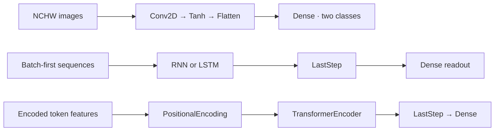

# Neural network examples

[nn](../README.md) · [Layer contracts](../../docs/layers.md)

Run these commands from the repository root after `mise install --locked`.
Each example has a fixed seed, explicit error handling, and a convergence check.
Ordinary tests compile and execute the generated-data examples.

## Choose an example

| Example | Command | What it learns | Data |
| --- | --- | --- | --- |
| [Linear regression](linear/main.go) | `mise run example:linear` | A straight line with SGD. | Fixed numerical pairs. |
| [XOR](xor/main.go) | `mise run example:xor` | Nonlinear classification with a dense network. | Four binary pairs. |
| [Convolution](cnn/main.go) | `mise run example:cnn` | Horizontal versus vertical line orientation. | Four generated 4×4 images. |
| [RNN](rnn/main.go) | `mise run example:rnn` | The sum of a three-number sequence from its final hidden state. | Four generated sequences. |
| [LSTM](lstm/main.go) | `mise run example:lstm` | Recall the first bit after reading the last bit. | All eight three-bit sequences. |
| [Transformer](transformer/main.go) | `mise run example:transformer` | Recover the first token at the final position. | Eight sequences with fixed feature encoding. |
| [MNIST](mnist/README.md) | `mise run example:mnist` | Digit classification with a dense network. | Explicitly downloaded local IDX files. |

The convolution, RNN, LSTM, and transformer examples require the development checkout.
They are not included in nn/v0.1.0.

## Model paths

## Check a training run

CNN, LSTM, and transformer runs must classify every training sample correctly.
Their final mean cross-entropy must be below `0.03`.
RNN predictions must be within `0.03` of each target sum.
Failures return an error and a nonzero process status.

Each iteration performs Forward, loss calculation, Backward, optimizer Step, and ZeroGrad.
Final predictions use Sequential.Predict, which disables graph recording.
The examples do not download data or require a GPU.

These datasets are training demonstrations.
They do not establish held-out accuracy or benchmark production workloads.
