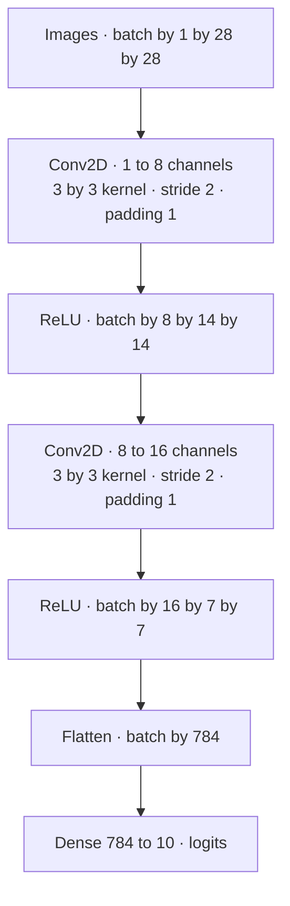
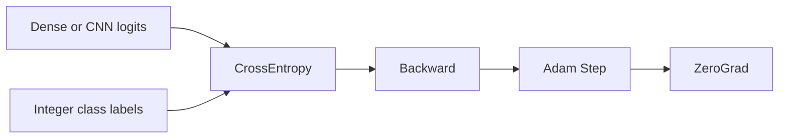

# MNIST training example

[Neural network guide](../../README.md) · [Project overview](../../../README.md)

This example trains a dense classifier or a convolutional neural network on local MNIST files.
Both models use a fixed seed, ReLU, stable cross-entropy, and Adam.
The program reports mean training cross-entropy after each epoch.

The CNN option requires the development checkout. It is not included in nn/v0.1.0.

Dataset downloads are explicit.
Unit tests use generated local IDX fixtures and do not access the dataset host.

## Prepare the data

Run these commands from the repository root:

```sh
mkdir -p data
curl -fL https://storage.googleapis.com/cvdf-datasets/mnist/train-images-idx3-ubyte.gz -o data/train-images-idx3-ubyte.gz
curl -fL https://storage.googleapis.com/cvdf-datasets/mnist/train-labels-idx1-ubyte.gz -o data/train-labels-idx1-ubyte.gz
mise run example:mnist
```

The data directory is ignored by Git.
Keep dataset files outside release commits.

## Configure the run

The default run uses 1,000 examples, three epochs, and batches of 32.
Pass flags after the mise task separator:

```sh
mise run example:mnist -- -limit 10000 -epochs 5 -batch 64
```

Select the CNN with `-model cnn`:

```sh
mise run example:mnist -- -model cnn -limit 1000 -epochs 3 -batch 32
```

| Flag | Default | Meaning |
| --- | --- | --- |
| `-images` | `data/train-images-idx3-ubyte.gz` | Local gzip-compressed image IDX file. |
| `-labels` | `data/train-labels-idx1-ubyte.gz` | Local gzip-compressed label IDX file. |
| `-model` | `dense` | Classifier architecture: `dense` or `cnn`. |
| `-limit` | `1000` | Number of examples selected from the files. |
| `-epochs` | `3` | Number of training epochs. |
| `-batch` | `32` | Maximum batch size. The last batch can be smaller. |

Limit, epochs, and batch must be positive.
Limit cannot exceed the available image and label counts.
An unknown model name returns an error before the program opens dataset files.

The loader reads complete IDX payloads before selecting the training limit.
A smaller limit reduces training arrays but does not reduce dataset-file reads.

## Model and training flow

Both models receive normalized images shaped `[batch,1,28,28]`.
The dense model flattens each image before its 784 → 32 → 10 network.
The CNN uses two 3×3 convolutions with stride 2 and padding 1:



Strided convolutions reduce the spatial dimensions without a separate pooling layer.
Both models produce `[batch,10]` logits and use the same training loop:



The random generator uses a fixed seed.
Adam uses rate 0.001, beta1 0.9, beta2 0.999, and epsilon 1e-8.
Batches use the selected data in file order.
The example does not add data shuffling or an evaluation split.
Conv2D allocates temporary patch matrices. Smaller batches reduce their memory requirement.

## Input validation

The loader checks gzip reads, IDX magic numbers, image dimensions, counts, and exact payload lengths.
Images must be 28 by 28 pixels.
Files must contain 1 through 60,000 items, and image and label counts must match.

The training loop validates selected labels in `[0,10)`.
Pixels are normalized by dividing each byte value by 255.

| Failure | Resolution |
| --- | --- |
| File cannot be opened | Check the supplied local path and download completion. |
| Invalid magic or dimensions | Supply MNIST IDX image and label files, not another archive or format. |
| Truncated or extra payload | Replace the damaged or incorrect file. |
| Limit exceeds available examples | Choose a smaller positive limit. |
| Invalid label | Check that the label file corresponds to the image file. |

## What the example establishes

The source compiles as part of nn's tests.
Fixture tests verify valid and malformed IDX data and a complete training step.
Both architectures run through multiple epochs and a partial final batch on local fixtures.
Model tests check logit shapes, finite gradients for every parameter, and seeded inference predictions.
The reported metric is training loss.

Real-dataset convergence and held-out accuracy were not measured for this checkout.
Do not treat fixture tests or lower training loss as an accuracy result.
