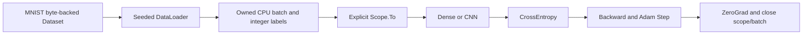

# MNIST training example

[Neural network guide](../../README.md) · [Data module](../../../data/README.md) · [Project](../../../README.md)

This application uses goml's Dataset and DataLoader APIs for local MNIST data.
Dense and CNN architectures, stable cross-entropy, Adam, checkpoint save/load,
weight-only restoration, and prediction are preserved. Dataset parsing,
normalization, target creation, shuffling, and batch construction belong to data.

The application is a separate development module so the nn library does not
depend on data or a concrete GPU backend. Use the committed workspace until
`data/v0.1.0` is published and the real application requirement can be added.
It has no independent release tag and no committed relative replace directives.

## Prepare local files

From the repository root, explicitly download both training and held-out files:

```sh
mkdir -p archive
curl -fL https://storage.googleapis.com/cvdf-datasets/mnist/train-images-idx3-ubyte.gz -o archive/train-images-idx3-ubyte.gz
curl -fL https://storage.googleapis.com/cvdf-datasets/mnist/train-labels-idx1-ubyte.gz -o archive/train-labels-idx1-ubyte.gz
curl -fL https://storage.googleapis.com/cvdf-datasets/mnist/t10k-images-idx3-ubyte.gz -o archive/t10k-images-idx3-ubyte.gz
curl -fL https://storage.googleapis.com/cvdf-datasets/mnist/t10k-labels-idx1-ubyte.gz -o archive/t10k-labels-idx1-ubyte.gz
mise run example:mnist -- -evaluate
```

Downloads never happen implicitly. Unit tests generate small local fixtures.
`archive/` is ignored; `data/` contains the library source. Plain IDX filenames
are supported too. Files are validated fully before a smaller sample limit is
selected. MNIST retains compact bytes rather than a complete Float32 dataset.

## Configure training

```sh
mise run example:mnist -- -data archive -model cnn -limit 1000 -epochs 3 -batch 32 -seed 42 -evaluate
```

| Flag | Default | Meaning |
| --- | --- | --- |
| `-data` | `archive` | Directory with standard local MNIST filenames. |
| `-split` | `train` | Select `train` or the held-out `test` files. |
| `-images`, `-labels` | Empty. | Optional explicit image/label pair, plain or gzip. Both must be set together. |
| `-model` | `dense` | `dense` or `cnn`; a loaded network supplies its own architecture. |
| `-limit` | `1000` | Number of examples selected; must not exceed the source length. |
| `-epochs` | `3` | Positive training epoch count; ignored in prediction. |
| `-batch` | `32` | Positive batch size; the last batch can be shorter. |
| `-shuffle` | `true` | Shuffle training batches deterministically each epoch. |
| `-seed` | `42` | Epoch-shuffle seed, independent of the fixed model initialization. |
| `-evaluate` | `false` | After each epoch, evaluate t10k files from `-data`. |
| `-device` | `cpu` | CPU, or `metal` in the opt-in Metal build. |
| `-save-model` | `archive/mnist-model.goml` | Architecture/weights checkpoint; empty disables saving. |
| `-save-weights` | `archive/mnist-weights.goml` | Weights-only checkpoint; empty disables saving. |
| `-load-model` | Empty. | Restore architecture and weights. |
| `-load-weights` | Empty. | Restore weights into the selected architecture. |
| `-predict` | `false` | Evaluate a loaded checkpoint without training or saving. |

Identical seed/epoch pairs produce identical sample orders. Model initialization
still uses its original fixed PCG seed. Prediction and evaluation keep source
order. `-evaluate` uses the first min(limit,10000) held-out examples; it requires
that many local test samples. It does not silently reuse training images.
Explicit image/label paths override the selected split for that input source.

## Models and training

Both models receive `[batch,1,28,28]` normalized CPU batches before an explicit
transfer to the selected device. The dense architecture remains 784 → 32 → 10.
The CNN keeps its two stride-two 3×3 convolutions and 784 → 10 readout.



Adam retains rate 0.001, beta1 0.9, beta2 0.999, and epsilon 1e-8. A helper owns
one batch's temporary scope, so cleanup runs before the next batch. The caller
closes every batch even on a training error. Parameters and Adam moments remain
on the selected device. Ctrl-C cancels subsequent dataset reads and iteration.

## CPU and Metal

The ordinary command is pure Go and requires no accelerator initialization.
Metal is an explicit optional application build, using the existing backend:

```sh
mise run example:data:mnist:metal -- -data archive -model cnn -limit 1000 -epochs 3
mise run test:data:metal
```

These tasks use `-tags metal`; native execution requires macOS, CGo, and supported
Metal hardware. The data and nn library modules do not import Metal. Only complete
CPU batches are transferred. Loss reporting explicitly downloads one scalar;
held-out prediction downloads final class scores for accuracy calculation.

## Checkpoints and held-out prediction

Training saves both checkpoint kinds by default. Output paths must differ.
A complete checkpoint restores its saved architecture. The two load flags are
mutually exclusive. Optimizer state and epoch counters are not saved.

```sh
mise run example:mnist -- -load-model archive/mnist-model.goml -split test -predict
mise run example:mnist -- -model cnn -load-weights archive/mnist-weights.goml -split test -predict
mise run example:mnist -- -load-model archive/mnist-model.goml -epochs 2
mise run example:mnist -- -save-model '' -save-weights ''
```

Prediction reports selected example count, accuracy, and weighted mean
cross-entropy, including a partial final batch. Use `-split test` for held-out
metrics; prediction on train or explicitly supplied training files measures that
source instead. Prediction requires a load flag and never rewrites checkpoints.

## Validation

```sh
mise run test:mnist
mise run lint:mnist
mise run bench:mnist
```

The data module owns strict IDX/gzip, label, count, and normalization tests.
Application tests cover both architectures, multiple epochs, partial batches,
shuffling, explicit held-out selection, parameter gradients, portable checkpoints,
restoration, weighted prediction loss, and inference without gradient creation.
Metal tests cover explicit transfer ownership and training both model choices.

See the [data performance report](../../../docs/performance/data.md) for measured
fixture timing and memory costs. Fixture validation is not a real-dataset accuracy
study, and no held-out accuracy result is claimed.
