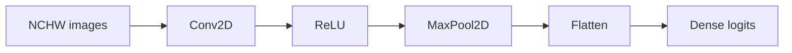

# Layers

[nn](../README.md) · [Activations](../activation/README.md) · [Checkpoints](../checkpoint/README.md) · [Layer contracts](../../docs/layers.md)

Package layer provides concrete trainable layers, spatial transformations, and Sequential composition.
It belongs to the nn module; it has no separate go.mod or release tag.
All computation uses float32 CPU tensors and supports eager differentiation.

## Choose a layer

| Constructor | Input and result | Parameters |
| --- | --- | --- |
| `NewDense(in, out, bias, rng)` | `[batch,in]` → `[batch,out]`. | Weight and optional bias. |
| `NewConv2D(in, out, kernel, stride, padding, bias, rng)` | NCHW → NCHW, square cross-correlation. | Flattened kernel and optional bias. |
| `NewMaxPool2D(kernel, stride, padding)` | NCHW → spatial maxima, with floor output sizes. | None. |
| `NewUpsample2D(scale, mode)` | NCHW → `[batch,channels,height*scale,width*scale]`. | None. |
| `NewFlatten()` | Preserves the batch dimension and flattens the remaining axes. | None. |
| `NewRNN(in, hidden, rng)` | `[batch,time,in]` → `[batch,time,hidden]`. | Input and recurrent projections. |
| `NewLSTM(in, hidden, rng)` | `[batch,time,in]` → `[batch,time,hidden]`. | Four-gate projections. |
| `NewLastStep()` | Selects the final time step from a batch-first sequence. | None. |
| `NewLayerNorm(features, epsilon)` | Normalizes the final feature axis. | Scale and bias. |
| `NewMultiHeadAttention(features, heads, causal, rng)` | Batch-first self-attention with matching input/output shapes. | Query, key, value, and output projections. |
| `NewPositionalEncoding()` | Adds fixed sinusoidal positions to sequences. | None. |
| `NewTransformerEncoder(features, heads, feedForward, rng)` | Batch-first encoder with attention, normalization, and residual paths. | Attention and feed-forward parameters. |

SiLU, pooling, and configurable upsampling are available in nn v0.3.0.
Other listed layers are available in nn v0.2.0.
See GoDoc for each constructor's validation, numerical behavior, and exact parameter ordering.

## Compose a model

Given a caller-owned `*rand.Rand` named rng:

```go
conv, err := layer.NewConv2D(1, 8, 3, 1, 1, true, rng)
if err != nil {
    return err
}

pool, err := layer.NewMaxPool2D(2, 2, 0)
if err != nil {
    return err
}

readout, err := layer.NewDense(8*14*14, 10, true, rng)
if err != nil {
    return err
}

model, err := layer.NewSequential(conv, activation.NewReLU(), pool, layer.NewFlatten(), readout)
if err != nil {
    return err
}
```

This model accepts batches of `[batch,1,28,28]` images and returns `[batch,10]` logits.
Dense and Conv2D use seeded Xavier initialization; biases start at zero.
Sequential copies its layer list and discovers shared parameters once.
Forward preserves gradients; Predict accepts a plain tensor and disables graph construction.



## Spatial interpolation

Choose a mode explicitly:

```go
upsample, err := layer.NewUpsample2D(2, layer.Bilinear)
if err != nil {
    return err
}
```

| Mode | Sampling rule | Behavior |
| --- | --- | --- |
| `layer.Nearest` | Source index `destination/scale`. | Repeats pixels exactly. Used by YOLOv8n. |
| `layer.Bilinear` | Half-pixel centers, four neighbors. | `align_corners=false`, replicated edge pixels. |
| `layer.Bicubic` | Half-pixel centers, sixteen neighbors. | Cubic coefficient -0.75; values may exceed the input range. |

Scale is a positive integer, equal on both spatial axes.
Interpolation does not apply antialias filtering.
All three modes differentiate with respect to their input; backward sums weighted contributions.
Pooling pads with negative infinity, selects the first finite maximum on ties, and propagates the first NaN in a window.
Overlapping pooling windows accumulate gradients into the selected source locations.

## State, ownership, and persistence

RNN.ForwardState and LSTM.ForwardState accept explicit initial states and return final states.
Ordinary Forward starts with zero state on each call.
Layers do not keep hidden state between unrelated requests.

Parameters own immutable tensor values; updates preserve parameter identity.
Training and updates require external synchronization.
Inference may run concurrently while parameters remain unchanged.
Save complete built-in Sequential models through [checkpoint.Save](../checkpoint/README.md#save-and-restore-a-network).
MarshalConfig and Restore expose architecture-only operations for tooling.

## Run and verify

```sh
mise run test:nn
mise run lint:nn
mise run example:cnn
mise run example:rnn
mise run example:lstm
mise run example:transformer
```

Tests include scalar references, finite-difference gradients, shape failures, and serialization round trips.
Conv2D currently supports square kernels, equal strides, symmetric zero padding, groups=1, and dilation=1.
It does not provide padding modes, grouped convolution, or a GPU backend.
