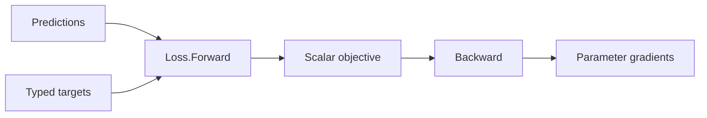

# Losses

[nn](../README.md) · [Optimizers](../optimizer/README.md) · [Training examples](../examples/README.md)

Package loss computes differentiable scalar objectives from predictions and typed targets.
It belongs to the nn module and uses tensor operations through nn.

## Choose an objective

| Constructor | Prediction | Target | Reduction |
| --- | --- | --- | --- |
| `NewMSE()` | Nonempty Value. | Value with the exact same shape. | Mean squared difference over all elements. |
| `NewCrossEntropy()` | Logits `[batch,classes]`, with positive dimensions. | `[]int` of length batch, each class index in range. | Mean negative log-likelihood over the batch. |

CrossEntropy uses a stable log-sum-exp formulation.
Pass logits directly; applying Softmax first changes the objective.
MSE differentiates through both prediction and target when each requires gradients.
CrossEntropy's integer targets do not receive gradients.
See GoDoc for numerical edge cases and error behavior.

## Compute a classification loss

Given a logits Value and a class-index slice named targets:

```go
objective := loss.NewCrossEntropy()

value, err := objective.Forward(logits, targets)
if err != nil {
    return err
}

if err := value.Backward(); err != nil {
    return err
}
```

The returned Value is rank zero, so Backward supplies the scalar seed.
A normal backward pass consumes the graph.
Build a fresh forward pass for the next training iteration.

## Typed substitution

The narrow interface preserves target types:

```go
var regression loss.Loss[*nn.Value] = loss.NewMSE()
var classification loss.Loss[[]int] = loss.NewCrossEntropy()
```

Use concrete loss types when substitution is unnecessary.
Losses own no trainable parameters or optimizer state.
Inference inputs compute the objective without constructing an autograd graph.



## Verify

```sh
mise run test:nn
mise run example:linear
mise run example:xor
```

Tests check values, finite-difference gradients, broadcasting restrictions, invalid labels, and shape failures.
