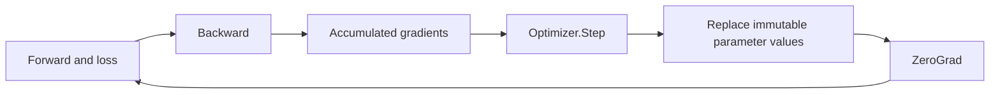

# Optimizers

[nn](../README.md) · [Losses](../loss/README.md) · [Checkpoints](../checkpoint/README.md)

Package optimizer updates trainable nn.Parameters using their accumulated gradients.
It provides concrete SGD and Adam implementations and a narrow Optimizer interface.
Optimizer state belongs to the optimizer, separate from tensor storage and autograd graphs.

## Choose an optimizer

| Constructor | State | Constraints |
| --- | --- | --- |
| `NewSGD(parameters, learningRate)` | Parameter references. | Learning rate must be finite and positive. |
| `NewAdam(parameters, learningRate, beta1, beta2, epsilon)` | First and second moments and a step count per parameter. | Positive finite rate and epsilon; finite betas in `[0,1)`. |

Constructors copy and deduplicate parameter lists.
Adam allocates state lazily when a parameter first receives a gradient.
A parameter without a gradient is skipped; its Adam moments and counter do not advance.
Common Adam settings are rate `0.001`, beta1 `0.9`, beta2 `0.999`, and epsilon `1e-8`.

## Update a model

Given a Sequential model:

```go
trainer, err := optimizer.NewAdam(model.Parameters(), 0.001, 0.9, 0.999, 1e-8)
if err != nil {
    return err
}
```

After computing the scalar loss and calling Backward:

```go
if err := trainer.Step(); err != nil {
    return err
}

trainer.ZeroGrad()
```

Step leaves gradients available until ZeroGrad clears them.
This permits deliberate accumulation across multiple forward/backward passes.
Use one optimizer for a shared parameter set so a parameter receives one update per step.



## Ownership and persistence

Updates replace each parameter's immutable tensor data and preserve its trainable leaf identity.
Existing tensor views keep their previous values.
Training, optimizer updates, and gradient clearing require external synchronization.
Concurrent inference is safe only while parameters remain unchanged.

Checkpoint files save model architecture and weights; they do not save Adam moments or step counts.
Create a new optimizer after restoring a checkpoint.
This starts a new optimization history from the saved weights.

## Verify

```sh
mise run test:nn
mise run lint:nn
mise run example:linear
mise run example:xor
```

Tests compare SGD and bias-corrected Adam updates with independent calculations and check shared parameter handling.
Momentum, schedules, clipping, and optimizer-state serialization are outside the current API.
