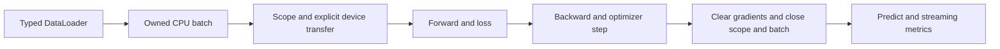

<div align="center">


# trainer

**Typed training loops, validation metrics, and checkpoints for goml models.**


[Quick start](#quick-start) · [Metrics](#pluggable-metrics) · [Ownership](#ownership) · [Examples](#examples) · [Project](../README.md)

</div>

---

trainer combines ordinary nn models, optimizers, and data loaders. Classification
uses stable cross-entropy on logits; regression uses mean squared error. Each
batch gets explicit device transfers, eager backpropagation, optimizer updates,
gradient clearing, and immediate temporary cleanup. Evaluation uses Predict
without an autograd graph or optimizer updates.

The module is `github.com/bpradana/goml/trainer`, with an initial release target
of `trainer/v0.1.0`. During development, use the committed Go workspace. Its
versioned dependencies are published; Trainer itself remains untagged.
The core imports no concrete GPU backend and compiles without CGo.

## Quick start

Create your model, place parameters explicitly, and then construct an optimizer.
Existing layer.Sequential models and nn optimizers satisfy Trainer's contracts.
The [complete classification program](examples/classification/main.go) includes
model construction, a generated dataset, and cleanup.

```go
runner, err := trainer.NewClassifier(model, opt, device, 10)
if err != nil {
	return err
}

history, err := runner.Fit(ctx, trainLoader, validationLoader, trainer.FitOptions{
	Epochs: 10,
	OnEpochEnd: func(report trainer.EpochReport) error {
		fmt.Printf("epoch=%d train_loss=%.4f val_accuracy=%.2f%%\n",
			report.Epoch, report.Train.MeanLoss, 100*report.Classification.Accuracy)

		return nil
	},
})
if err != nil {
	return err
}
```

The callback above assumes validation is enabled. Pass nil as validationLoader
for training alone; Validation and task metric pointers will then be nil.
Classification loaders yield `*data.ClassificationBatch`; regression loaders yield
`*data.RegressionBatch`. Their sample type is irrelevant to Trainer.

For regression, use `NewRegressor(model, opt, device)` with the same Fit pattern.
Predictions and targets must have exactly equal shapes, including the leading
sample dimension. Loss is weighted by sample count, including partial batches.
Regression metrics flatten outputs into equally weighted scalar observations.

## Pluggable metrics

Custom metrics implement the small `metrics.Accumulator[P,T]` contract:

```go
type Accumulator[P, T any] interface {
	Update(predictions []P, targets []T) error
	Reset()
}
```

Pass any number of accumulators to NewClassifier or NewRegressor. Implementations
can expose any concrete Result type; Trainer does not erase it into a dynamic map.
The [custom mean-bias metric](../metrics/examples/custom/README.md) is used directly
by the [regression program](examples/regression/main.go):

```go
bias := meanbias.New()
runner, err := trainer.NewRegressor(model, opt, device, bias)
if err != nil {
	return err
}

history, err := runner.Fit(ctx, trainLoader, validationLoader, trainer.FitOptions{
	Epochs: 20,
	OnEpochEnd: func(report trainer.EpochReport) error {
		result, err := bias.Result()
		if err != nil {
			return err
		}

		fmt.Println(report.Epoch, result.MeanBias)
		return nil
	},
})
```

Classification plugins receive flattened `[samples,classes]` raw logits and
integer targets. Use `classification.Logits()` to plug a built-in Classification
accumulator into that boundary. Regression plugins receive flattened Float32
prediction and target slices; the built-in Regression implements this directly.
The standalone EvaluateClassification/EvaluateRegression functions accept the
same optional metrics without constructing an optimizer.

Metrics reset once at the start of each evaluation and update once per batch.
They reuse the predictions already downloaded for evaluation. Training-only Fit
does not update them. Read typed results in OnEpochEnd or after evaluation; save
your own snapshots if you need custom metric history. Built-in metric snapshots
remain in EpochReport. On evaluation failure, custom state may contain the
successful prefix; the next evaluation resets it. Update must not mutate or
retain borrowed slices. Accumulators and runners require caller synchronization.

## Validation, stopping, and checkpoints

Fit returns completed epoch reports even when a later batch, callback, or
checkpoint fails. EpochReport.Epoch starts at one; data loaders receive epochs
starting at zero. There is no implicit logging.

```go
options := trainer.FitOptions{
	Epochs:             100,
	EarlyStopping:      &trainer.EarlyStopping{Patience: 5, MinDelta: 0.001},
	BestCheckpointPath: "archive/best.goml",
}
```

Both options require validation. An improvement must exceed MinDelta to reset
patience; the first evaluation establishes the baseline. Patience consecutive
misses stop before the next epoch. Best checkpoint selection independently saves
every strictly lower validation loss using nn/checkpoint's atomic file writes.
Sequential checkpoints contain supported architecture and weights; custom Model
implementations use weights-only checkpoints. Unsupported architecture codecs
return errors. The best model is not restored automatically.

Checkpoints do not include optimizer moments or step counters. They are not full
training-state snapshots. Callback and checkpoint failures return errors without
rolling back parameter updates already completed.

## Ownership

The application owns the model, optimizer, selected device, and metric instances.
Move model parameters with nn.ToDevice before creating the optimizer. Trainer
validates placement and never migrates parameters, initializes accelerators, or
falls back to CPU implicitly. Call Close on resource-owning optimizers yourself.

Trainer owns each successfully yielded batch and closes it after use on every
path. Per-batch Tensor scopes close transfers and operation temporaries; gradients
are cleared before and after training steps, including failures. Model outputs
must be owned handles and propagate Tensor scopes through ordinary Tensor
operations. Return a retained handle when exposing existing parameter storage.
No per-operation synchronization is added; scalar loss reporting and validation
host reads synchronize through Tensor's normal API.



## Custom steps

Generic `trainer.Fit[B]` accepts typed training and evaluation StepFunc functions
for arbitrary data.Loader batches and losses. A step returns a finite MeanLoss
and positive Samples count. It owns its batch, numerical operations, temporary
resources, and gradient cleanup, even when the context is canceled. The
[regularized reconstruction example](examples/custom/README.md) demonstrates this
without a task registry or a universal batch type. Save custom checkpoints from
OnEpochEnd; generic Fit has no model from which to infer a checkpoint.

## Examples

| Program | Purpose |
| --- | --- |
| [Classification](examples/classification/README.md) | Seeded two-class training with validation and progress callbacks. |
| [Regression](examples/regression/README.md) | Synthetic linear regression, Adam, and a custom mean-bias metric. |
| [Custom step](examples/custom/README.md) | Regularized reconstruction with an arbitrary Tensor batch. |
| [MNIST](../nn/examples/mnist/README.md) | Local MNIST, dense/CNN choices, held-out evaluation, checkpoints, and optional GPU execution. |

```sh
mise run example:trainer
mise run test:trainer
mise run test:trainer:race
mise run test:standalone:trainer
mise run lint:trainer
```

Optional `test:trainer:metal` and `test:trainer:webgpu` run on supported hardware.
See the [training guide](../docs/training.md) and
[performance report](../docs/performance/trainer.md) for evidence and limits.

Licensed under [MIT](../LICENSE).
